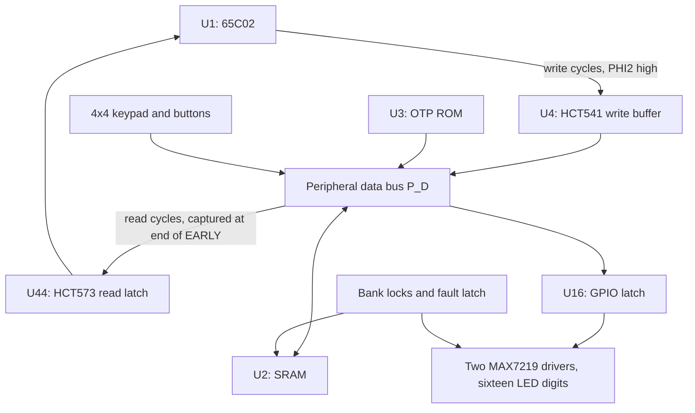

# DTS-02 — 65C02 Ed25519 desktop signer

Breadboard specification, component list, and wiring plan

Revision 0.5 · 28 October 2026
Status: unbuilt engineering proposal with pin-level breadboard wiring. Revision 0.5 replaces the discrete shift-register display and DIP-switch input with two MAX7219 LED drivers and a 4×4 membrane keypad (Section 8). Revision 0.4 applied the findings of the revision 0.3 simulation (FINDINGS.md). A generated hole-level wiring list (wiring/WIRING.md) accompanies this revision. No board has been assembled and no timing has been measured.

This is a self-contained specification for a small computer using a modern 6502-family CPU, ordinary SRAM, fixed program ROM, keypad input, and seven-segment LED output. Its intended job is plain Ed25519 signing of Solana message bytes, as a distinct third signing device in a 2-of-3 Squads setup.

The design below supplies a seven-breadboard placement map, a component list, named nets, DIP pin tables, clock/reset circuits, a bus-handoff timing model, and staged bring-up instructions. The front panel and power fixture use passive perfboard. No complete 6502 Ed25519 firmware is supplied. The included diagnostic ROM generator exercises the bus only.

Build this revision with public test keys. It implements a computer, manual I/O, and experimental memory locks. The independent wipe sequencer, CPU power-domain isolation, restricted post-wipe output controller, complete signing firmware, and Solana/Squads authorization parser remain engineering work. They are explicitly listed in Section 12. The solderless prototype is not a finished custody device.

## Changes from revision 0.4

- **Display: two MAX7219 drivers instead of sixteen 74HC595s.** U21 and U22 are daisy-chained MAX7219 (or pin-compatible AS1107/HT7219) 8-digit multiplexed drivers on a 3-wire serial interface from the existing GPIO latch. They replace U20, U23–U36, 128 segment resistors and 20 series resistors; U19 becomes a 3-line display interface buffer. Brightness is set in firmware.
- **Hardware blanking kept.** The MAX7219 has no output enable, so DISPLAY_ON (CPU_RESET_N & DISPLAY_ENABLE & FAULT_N) now switches the display supply through a jellybean PNP/NPN pair; an unpowered MAX7219 is blank and powers up in shutdown.
- **Input: 4×4 membrane keypad instead of the DIP switch.** Rows are driven from four freed GPIO bits through Schottky diodes and columns are read through U14 with its existing pull-ups. A byte is two key presses instead of eight switch settings plus ENTER.
- **Fewer parts.** 30 ICs (28 DIP) instead of 45, seven breadboards instead of ten.

## Changes from revision 0.3

- **Six-state phase generator.** The spare flip-flop of U45 becomes a third Johnson stage (Q_C). A CPU cycle is now six master periods: PHI2 is high for EARLY, MID and LATE. The read window is EARLY+MID and closes one full master period before PHI2 falls, so the CPU's address change at the PHI2 fall can no longer meet an active output enable. Revision 0.3 depended on an HCT00 delay beating the CPU address hold, which failed by up to about 15 ns at datasheet corners and produced up to about 28 ns of P_D overlap in simulation. RD_WIN_N moves from U10 gate 3 to U18 gate 2 (spare three-input NAND); U10 gate 3 is unused. No parts are added (Sections 5.5, 6.4, 6.5, 7).
- **Separate fault-latch clock.** U38 is clocked by PHI2_FAULT from a spare U7 gate instead of the CPU PHI2 net, which no longer leaves BB1. Revision 0.3 hung a roughly 400 mm stub on the clock that must reach the CPU with a ≤5 ns edge (Sections 5.4, 9.2).
- **Oscillator capacitor 330 pF → 560 pF.** Over the SN74HC14 threshold range, 10 kΩ/330 pF spans about 127–890 kHz, not 300–380 kHz. 560 pF spans about 76–530 kHz master, 13–88 kHz CPU, which keeps the 100 kHz CPU ceiling at every corner (Section 5.3).
- **Acceptance criteria re-based.** Bus rise-time limits now follow the HCT input-transition limit rather than a 60 pF budget that a ten-board breadboard cannot meet. Wire-length targets are replaced by capacitance (Sections 3.2, 6.5, 11.2).
- **Text corrections.** Reset-release delay range, regulator current, the boot sequence's invalid `STA #$00`, and the stack self-test scope in the recovery states (Sections 5.1, 5.3, 10.1).

## Changes from revision 0.2

- **Bus interface rebuilt.** The permanently enabled bidirectional HCT245 is replaced by a windowed write buffer (U4, HCT541), a read latch (U44, HCT573) and a cycle-direction register (U45, half of an HCT74). Every peripheral-bus driver is enabled only inside the PHI2-high window of its own cycle type; the latch captures read data at the end of EARLY and keeps driving the CPU for one full master period after PHI2 falls. Any two drivers of either data bus are therefore separated by at least one master period, enforced by the Johnson counter rather than by unspecified gate-delay minima (Section 6.5).
- **Bus pull-ups re-specified.** Peripheral-bus pull-ups change from 47 kΩ to 4.7 kΩ with an explicit 60 pF-per-line capacitance budget and a measured rise-time acceptance check. 10 kΩ pull-ups are added to the CPU-side data bus so that no CMOS input floats.
- **Input buffers U14/U15 become HCT541**, whose two enables combine the port select and the read window without extra gates.
- **Oscillator capacitor 1 nF → 330 pF.** The revision 0.2 values produced roughly 100 kHz master / 25 kHz CPU, four times slower than the timing text assumed. The new target is about 300–380 kHz master, 75–95 kHz CPU, never above 400 kHz / 100 kHz.
- **Supervisor MCP130-475 → MCP130-460** (4.35–4.60 V trip). The 4.75 V upper trip point left about 50 mV to the regulator's guaranteed minimum; a rail acceptance check is added.
- **Battery fixture six → eight AA cells.** With a 7.5 V regulator-input floor, six alkaline cells were exhausted at 1.3 V per cell, leaving roughly half their capacity unused.
- **Firmware boot/reset state machine defined** (Section 10.1). Locks and FAULT that survive a CPU reset now have specified behavior; fault paths are stack-free because FAULT blocks every SRAM write, including the stack.
- **Squads transaction-index race and durable-nonce consumption** are specified, with a required adversarial integration test (Section 10.5).
- **RFC 8032 acceptance vector corrected.** The revision 0.2 text carried a duplicated 0x5f byte at the line break and concatenated to 65 bytes.
- **Status LEDs** for MESSAGE_LOCK, RESULT_LOCK and FAULT are now standard, because the panel is hardware-blanked on FAULT and the LED is the only visible fault indication.
- **BB10 added** for the bus interface. IC count 45 (43 DIP). The diagnostic ROM image is unchanged.

## Contents

1. Architecture and design boundary
2. Bill of materials
3. Physical breadboard layout
4. Nets, memory map, and ports
5. Power, reset, and clock
6. CPU, memory, and bus interface
7. Address decoding and strobe timing
8. Input and display wiring
9. Message, result, and fault latches
10. Firmware and cryptographic contract
11. Bring-up and diagnostic ROM
12. Completion requirements for a live-key signer
13. Sources and validation record

## 1. Architecture and design boundary

The W65C02S is an 8-bit processor with a 16-bit address bus. Multi-byte arithmetic implements Ed25519 and SHA-512. The proposed 32 KiB ROM and 16 KiB secret-workspace allocations are design targets until complete firmware is linked and its stack/memory use checked. Manufacturer pinouts and electrical limits are referenced in Section 13.



The circuit intentionally has no USB, radio, Ethernet, camera, SD-card controller, filesystem, bootloader, or display firmware. A programmer and logic analyzer are development tools used with public data. The battery fixture provides an eventual disconnected operating mode; plugging in test equipment creates a connection and is outside that mode.

This architecture still trusts its ICs and program image. It exposes working secrets on an ordinary bus when live-key firmware is eventually used. Smaller hardware and fixed ROM reduce the inspection scope; they do not prove honest silicon or provide secure-element physical protection. Keep all three multisig seeds independently generated and separately stored.

## 2. Bill of materials

### 2.1 Installed ICs

These are specific candidate parts/packages, not a claim that every distributor has stock. Use traceable distribution and verify the exact package drawing before placing parts. N and E denote through-hole packages for the listed TI families; do not substitute a surface-mount suffix accidentally. Speed suffix substitutions require renewed timing review.

| Reference | Qty | Candidate part | Package | Function |
|---|---:|---|---|---|
| U1 | 1 | WDC W65C02S6TPG-14 | PDIP-40, 0.6 in | CPU |
| U2 | 1 | Alliance AS6C62256-55PCN / -55PIN | PDIP-28, 0.6 in | 32 KiB SRAM; select exact qualified suffix |
| U3 | 1 | Microchip AT27C256R-45PU / -70PU | PDIP-28, 0.6 in | 32 KiB OTP ROM; buy at least 3 blanks for development |
| U4 | 1 | TI SN74HCT541N | PDIP-20 | WBUF: CPU→peripheral write buffer, enabled only in PHI2-high write cycles |
| U5, U17 | 2 | TI SN74HC14N | PDIP-14 | Clock/reset Schmitt gates; button conditioning |
| U6, U37, U38, U45 | 4 | TI SN74HCT74N | PDIP-14 | PHASE Johnson counter; two lock/fault packages; cycle-direction register and third Johnson stage |
| U7 | 1 | TI SN74AC14N | PDIP-14 | Fast CPU clock buffer and separate fault-latch clock; actual edge qualification required |
| U8 | 1 | TI SN74HCT04N | PDIP-14 | INV: bus/address inversions |
| U9 | 1 | TI CD74HC30E | PDIP-14 | PAGE: eight-input NAND for $7Fxx decode |
| U10 | 1 | TI SN74HCT00N | PDIP-14 | NAND: RAM select, write window, hold term |
| U11, U40 | 2 | TI SN74HCT08N | PDIP-14 | AND: timing/reset, latch output enable, protection predicates |
| U12, U41 | 2 | TI SN74HCT32N | PDIP-14 | OR: GPIO strobe, RAM write enable, security latches |
| U13 | 1 | TI SN74HCT138N | PDIP-16 | PORT: eight I/O selects |
| U14, U15 | 2 | TI SN74HCT541N | PDIP-20 | Byte/key input buffers; enables = port select AND read window |
| U16 | 1 | TI SN74HCT273N | PDIP-20 | Eight-bit GPIO/display-control latch |
| U18 | 1 | TI CD74HC10E | PDIP-14 | Three-input NAND: default/fault display blanking and the read window |
| U19 | 1 | TI SN74HCT244N | PDIP-20 | Display interface buffer, enabled only while the display is powered |
| U21, U22 | 2 | Analog Devices (Maxim) MAX7219CNG; ams-OSRAM AS1107; HTCSEMI HT7219 | PDIP-24, 0.6 in | Daisy-chained 8-digit LED drivers |
| U39 | 1 | TI CD74HCT157E | PDIP-16 | Select message/result bank lock |
| U42 | 1 | Microchip MCP130-460DI/TO | TO-92, D bondout | Power supervisor; 4.35–4.60 V trip range |
| U43 | 1 | ST L7805ACV | TO-220 | 5 V linear regulator for battery fixture |
| U44 | 1 | TI SN74HCT573N | PDIP-20 | RLATCH: peripheral→CPU read latch, transparent during EARLY |

Installed total: 30 ICs, including the supervisor and regulator; 28 are DIP packages. Reference designators U20 and U23–U36 are unused in this revision. The lock daughterboard accounts for five of those DIP ICs and the bus-interface board BB10 for three (U4, U44, U45). Sixteen LED packages, two transistors and the keypad are additional.

### 2.2 Display, controls, passives, and construction

Quantities below cover the populated seven-board design. Buy modest spares.

| Qty | Item / value | Allocation |
|---:|---|---|
| 16 | Kingbright **SC56-11EWA**, raw common-cathode seven-segment digit | D0–D15, left to right |
| 2 | 47 kΩ, 1%, ≥1/8 W | MAX7219 RSET (ISET to DISP_V) |
| 1 | 150 Ω, ≥1/8 W | Q1 base drive |
| 14 | 4.7 kΩ, ≥1/8 W | Eight pull-ups on P_D0–P_D7 (Section 6.5), supervisor output pull-up, three status-LED resistors, Q2 base, Q1 base pull-up |
| 30 | 10 kΩ, ≥1/8 W | Eight U14 input pull-ups (four keypad columns, four spare), five keys, five CPU control inputs, one oscillator feedback resistor, eight pull-ups on C_D0–C_D7, three display-line pull-downs |
| 1 | 100 kΩ, ≥1/8 W | CPU reset-release RC charging resistor |
| 10 | 1 kΩ, ≥1/8 W | Five key discharge resistors, CPU reset button, reset-diode current limiting, three display-line series resistors |
| 1 | 1 kΩ, **1/4 W** | Permanent 5 V rail bleeder/minimum-load resistor |
| 35 | 100 nF ceramic, ≥16 V, short leads | 28 DIP bypasses (U21/U22 on DISP_V), supervisor bypass, regulator output bypass, five key RCs |
| 9 | 10 µF electrolytic, ≥10 V | One local bulk capacitor per breadboard, plus one at each MAX7219 V+ |
| 1 | 560 pF C0G/NP0, ≥16 V | Oscillator capacitor (Section 5.3) |
| 1 | 1 µF, ≥10 V | CPU reset-release RC capacitor |
| 1 | 330 nF, ≥25 V | Regulator input bypass |
| 1 | 100 µF electrolytic, ≥25 V | Battery/regulator input bulk |
| 1 | 47 µF electrolytic, ≥10 V | Regulator output bulk |
| 1 | 1N4148 signal diode | Fast reset-RC discharge path, through 1 kΩ |
| 1 | 1N5819 Schottky diode | Battery reverse-polarity protection |
| 4 | BAT85 (or BAT43, 1N5711-class) small-signal Schottky diode | Keypad row diodes DK1–DK4 |
| 1 | BC327-25 PNP, TO-92 (or 2N2907A) | Q1 display supply switch |
| 1 | 2N3904 NPN, TO-92 (or 2N2222A, BC337) | Q2 display switch driver |
| 3 | 3 mm LEDs: red for FAULT, yellow for MESSAGE_LOCK and RESULT_LOCK | Status indicators, Section 9.2 |
| 1 | 4×4 membrane matrix keypad, 8-pin 2.54 mm connector | Hex entry (Section 8) |
| 5 | Normally-open momentary switches | ENTER, NEXT, BACK, APPROVE, ABORT |
| 1 | Normally-open momentary switch | CPU RESET, electrically separate from cold clear |
| 1 | SPST power switch, ≥1 A at 15 V DC | Battery input disconnect |
| 1 | 500 mA fuse and holder | Battery positive lead |
| 1 | Eight-AA holder plus eight alkaline AA cells | Battery fixture, about 12 V fresh |
| 1 | TO-220 heatsink, ≤15 °C/W, with hardware | U43; keep off solderless contacts |
| 7 | Good-quality 830-tie, 63-row solderless breadboards | BB1–BB5, BB9, BB10; buy at least one spare |
| 1 | Passive perfboard about 250 × 30–50 mm | Single-row LED panel; two rows of eight are an alternative |
| 1 | Small passive perfboard and screw terminals | Fused battery/regulator fixture |
| As needed | 22 AWG solid insulated hookup wire, ground returns, labels | Point-to-point wiring and labelled harnesses |
| 3 blanks recommended | AT27C256R OTP devices | One installed at a time; development consumes blanks |

Development tools: a current-limited 5 V supply, DMM, EPROM programmer that explicitly supports the chosen AT27C256R, independent ROM readback, and an oscilloscope with enough bandwidth and a suitable probe to assess a 5 ns clock edge and the bus handoffs of Section 11.2. A logic analyzer helps decode the bus but cannot replace analog edge/contention measurements. The tools are external equipment and are not components of the disconnected signer.

## 3. Physical breadboard layout

### 3.1 Coordinate convention

Each board has rows 1–63 and columns a–j. For each row, a–e form one terminal strip and f–j form another. The long power rails may be split halfway: check continuity, then bridge the intended sections deliberately. Confirm this topology on the actual breadboard before wiring.

View the component side from above. Every DIP notch points toward the smaller row number. For an N-pin DIP beginning at row r:

- Left-side pins 1 through N/2 run downward from row r.
- The highest-numbered pin N is opposite pin 1, and the right-side pins decrease as rows increase.
- Narrow 0.3-inch DIPs use columns e/f.
- The 0.6-inch CPU and memories use c/g in the assumed board geometry. Measure the pin-row separation; a different breadboard may need a passive adapter. Do not force the legs into e/f.

The row ranges identify occupied terminal strips, not complete wire-routing paths. Every signal connection is specified by the pin tables below. Place each bypass capacitor immediately next to its IC supply pins, using free holes in the corresponding strips and the nearest return.

### 3.2 Board arrangement

Orient each breadboard with its long dimension north–south. The arrangement below keeps the CPU, the bus interface and the memories adjacent in that order; the two display drivers share BB5. Use approximately 15 mm between board edges. A roughly 420 × 420 mm baseplate is a planning allocation for common 55 × 165 mm boards plus the LED panel; confirm actual dimensions before fabrication.

| Position | Column 1 | Column 2 | Column 3 | Column 4 | Column 5 | Sidecar |
|---|---|---|---|---|---|---|
| North row | BB1 CPU/clock | BB10 bus interface | BB2 memory | BB3 decode/fanout | BB4 controls | BB9 locks |
| South row | BB5 display drivers | Switch, button and keypad panel | Fused power fixture | | | |
| Front edge | LED panel D0–D15, byte group labels | | | | | |

Keep U7-to-U1 PHI2 wiring short, preferably under 50 mm, with a nearby ground return; the CPU PHI2 net stays on BB1. C_D runs only between BB1 and BB10 and P_D from BB10 to BB2 and BB4. With this placement the generated wiring list gives roughly 280 mm per C_D line and 450–550 mm per P_D line, about 36 pF and 70 pF; the binding limits are the capacitance criteria of Section 6.5, not wire length. These estimates do not replace waveform measurements. Do not run display return current through the CPU ground jumper.

### 3.3 Exact DIP placement

For example, U1 begins at c41: pin 1=c41, pin 20=c60, pin 21=g60, and pin 40=g41. A signal connected to U1 pin 40 therefore uses the g41 terminal strip.

| Board | IC | Pin 1 location | Highest pin location | Occupied rows |
|---|---|---|---|---|
| BB1 | U5 | e14 | Pin 14 at f14 | 14–20 |
| BB1 | U6 | e23 | Pin 14 at f23 | 23–29 |
| BB1 | U7 | e32 | Pin 14 at f32 | 32–38 |
| BB1 | U1 | c41 | Pin 40 at g41 | 41–60 |
| BB10 | U4 | e2 | Pin 20 at f2 | 2–11 |
| BB10 | U44 | e14 | Pin 20 at f14 | 14–23 |
| BB10 | U45 | e26 | Pin 14 at f26 | 26–32 |
| BB2 | U3 | c2 | Pin 28 at g2 | 2–15 |
| BB2 | U2 | c19 | Pin 28 at g19 | 19–32 |
| BB2 | U8 | e36 | Pin 14 at f36 | 36–42 |
| BB2 | U9 | e45 | Pin 14 at f45 | 45–51 |
| BB2 | U10 | e54 | Pin 14 at f54 | 54–60 |
| BB3 | U11 | e2 | Pin 14 at f2 | 2–8 |
| BB3 | U12 | e12 | Pin 14 at f12 | 12–18 |
| BB3 | U13 | e22 | Pin 16 at f22 | 22–29 |
| BB3 | U19 | e33 | Pin 20 at f33 | 33–42 |
| BB4 | U14 | e2 | Pin 20 at f2 | 2–11 |
| BB4 | U15 | e15 | Pin 20 at f15 | 15–24 |
| BB4 | U16 | e28 | Pin 20 at f28 | 28–37 |
| BB4 | U17 | e41 | Pin 14 at f41 | 41–47 |
| BB4 | U18 | e51 | Pin 14 at f51 | 51–57 |
| BB5 | U21 | c3 | Pin 24 at g3 | 3–14 |
| BB5 | U22 | c18 | Pin 24 at g18 | 18–29 |
| BB9 | U37 | e3 | Pin 14 at f3 | 3–9 |
| BB9 | U38 | e14 | Pin 14 at f14 | 14–20 |
| BB9 | U39 | e25 | Pin 16 at f25 | 25–32 |
| BB9 | U40 | e37 | Pin 14 at f37 | 37–43 |
| BB9 | U41 | e48 | Pin 14 at f48 | 48–54 |

BB1 rows 2–11 (freed by moving U4) carry the eight 10 kΩ C_D pull-ups next to the CPU data pins' harness entry. BB10 rows 36–50 carry the eight 4.7 kΩ P_D pull-ups and the P_D harness terminations. BB5 rows 33–55 carry Q1, Q2, their resistors, the two RSET resistors and the DISP_V bulk capacitors. U42 and U43 belong on the power perfboard. Mount the TO-220 regulator mechanically with its heatsink; do not suspend its weight from solderless contacts. The DIP switch and pushbuttons can sit on a separate passive panel or free terminal strips, with the individual connections shown in Section 8.

### 3.4 Harness labels

| Harness | Nets | Wiring rule |
|---|---|---|
| CPU address | A0–A15, GND | Address labels at both ends; never infer order from wire color alone |
| CPU data | C_D0–C_D7, GND | Only U1 pins 26–33, U4 inputs, U44 outputs and the 10 kΩ pull-ups connect here |
| Peripheral data | P_D0–P_D7, GND | U4 outputs, U44 inputs, RAM, ROM, U14/U15 outputs, U16 inputs, 4.7 kΩ pull-ups; rise-time limit of Section 11.2 item 7 |
| Core control | RWB, nRWB, PHI2, Q_A, /Q_A, Q_B, /Q_B, Q_C, /Q_C, EARLY, RD_WIN_N, RWB_CYCLE, HOLD_N, LATCH_OE_N, COLD_CLEAR_N, CPU_RESET_N | Keep clocks and window strobes away from LED-current loops |
| Lock interface | A13, A14, RAM_SELECT, nRWB, PHI2_FAULT, reset nets, Y3_N, Y4_N, WR_PHASE_N | Add WRITE_BLOCK and status returns |
| Display | MX_DIN, MX_CLK, MX_LOAD, DISPLAY_ON, +5 V, GND to BB5; SEGA_n–SEGDP_n and DIG0_n–DIG7_n (n = 0, 1) from BB5 to the LED panel | Keep the 32-wire panel bundle together; BB5 takes its own star ground from the power fixture |
| Keypad | KROW1–KROW4, KCOL1–KCOL4 | 8-wire ribbon from BB4 to the keypad connector |

Red is +5 V and black is GND throughout. Mark the battery input separately so it cannot be mistaken for the regulated logic rail. Do not attach the 12 V battery rail to a 5 V breadboard rail.

## 4. Nets, memory map, and ports

### 4.1 Naming

_N means active low. RWB=1 means CPU read; nRWB=!RWB. C_D is the CPU-side data bus (U1, U4 inputs, U44 outputs) and P_D is the peripheral data bus (U4 outputs, U44 inputs, RAM, ROM, U14/U15 outputs, U16 inputs). Never join C_D directly to P_D. RAM/ROM read highs can be as low as 2.4 V under their specified loads, while the CPU requires CMOS input levels; U44 (HCT inputs, CMOS outputs) provides the threshold translation on reads and U4 provides buffering on writes.

The six Johnson states (Q_A Q_B Q_C) are PRE (000: PHI2 low, last third of the low phase), EARLY (100: PHI2 high, first third), MID (110: PHI2 high, second third), LATE (111: PHI2 high, last third), POST (011: PHI2 low, first third after the fall) and GAP (001: PHI2 low, middle third). RWB_CYCLE is RWB registered at the PRE→EARLY edge; it holds the current cycle's direction until the next PRE→EARLY edge.

The local core aliases used in wiring tables are CPU=U1, RAM=U2, ROM=U3, WBUF=U4, PHASE=U6, INV=U8, PAGE=U9, NAND=U10, AND=U11, OR=U12, PORT=U13, RLATCH=U44 and CYC=U45.

COLD_CLEAR_N resets the phase generator, the cycle register and the experimental lock latches after a power event. CPU_RESET_N resets the CPU/GPIO and suppresses writes; pressing CPU RESET does not clear the lock/fault latches, and Section 10.1 defines what firmware does when it boots with them set. A brownout-triggered cold clear is not proof that RAM was erased.

### 4.2 Address map

| CPU address | Bytes | Allocation / rule |
|---|---:|---|
| `$0000–$00FF` | 256 | Zero page; secret scratch in a future live build |
| `$0100–$01FF` | 256 | CPU stack; secret scratch; explicit bounds |
| `$0200–$3FFF` | 15,872 | Crypto/parser workspace; together the lower bank provides 16 KiB mutable scratch |
| `$4000–$4FFF` | 4,096 | Complete raw message M |
| `$5000–$50FF` | 256 | Length, profile, expected key and public review metadata |
| `$5100–$5FFF` | 3,840 | Public reserved bytes; covered by MESSAGE_LOCK |
| `$6000–$60FF` | 256 | Public result record |
| `$6100–$7EFF` | 7,680 | Public reserved bytes; covered by RESULT_LOCK |
| `$7F00–$7FFF` | 256 | I/O; top 256 physical SRAM bytes are unmapped during CPU operation |
| `$8000–$FFFF` | 32,768 | Fixed OTP ROM, constants and vectors |

$5100–$5FFF and $6100–$7EFF are not secret workspace in this broad-lock implementation. A future independent wiper must still clear all physical non-result SRAM, including the normally unmapped top 256 bytes.

### 4.3 I/O ports

| Canonical address | Direction | Function |
|---|---|---|
| `$7F00` | Read | Keypad columns D0–D3 (active low while a row is driven), D4–D7 read 1 |
| `$7F01` | Read | D0 ENTER, D1 NEXT, D2 BACK, D3 APPROVE, D4 ABORT, D5 MESSAGE_LOCK, D6 RESULT_LOCK, D7 FAULT |
| `$7F02` | Write | GPIO/display control latch |
| `$7F03` | Write | Set MESSAGE_LOCK; data value ignored |
| `$7F04` | Write | Set RESULT_LOCK; data value ignored |
| `$7F05–$7F07` | Reserved | No device drives reads; bus pull-ups yield $FF |

A3–A7 are not decoded within the I/O page, so ports repeat every eight bytes. Firmware uses canonical addresses only. Reads of write-only ports also return pulled-up $FF. Do not use read-modify-write instructions on I/O; use an explicit software shadow and full-byte stores.

## 5. Power, reset, and clock

### 5.1 Regulated power fixture

For initial bring-up use a regulated, current-limited 5.0 V supply directly on the logic rails. Fit only the tested stage of the circuit; start with a low current limit and increase it only as known loads are added. Never connect a bench supply and the battery regulator simultaneously without a separately designed power selector.

The battery fixture is: eight-AA positive → 500 mA fuse → power switch → 1N5819 anode; diode cathode → U43 input. Battery negative → system GND. U43 is L7805ACV. With its marked face toward you and leads downward, pin 1 is input, pin 2 is ground, and pin 3 is +5 V output; its tab is ground. Confirm the ST drawing for the actual purchased package.

Place 330 nF and 100 µF from regulator input to GND, and 100 nF and 47 µF from output to GND. Keep these leads short and observe electrolytic polarity. Connect a permanent 1 kΩ / 1/4 W resistor across +5 V and GND; it provides about 5 mA load and a passive discharge path. It is not a verified secret-erasure mechanism.

Keep the regulator input at least 7.5 V after the reverse-polarity diode for the specified operating range. Eight alkaline cells read about 12.0–12.8 V fresh and reach the 7.9 V pack floor (7.5 V after the diode) at about 0.99 V per cell, which is close to end of life for alkaline chemistry; the six-cell fixture of revision 0.2 reached the same floor at 1.3 V per cell with roughly half of its capacity unused. Eight NiMH cells (9.6–11 V) are acceptable. Replace cells when the loaded pack voltage falls below 7.9 V.

Worst-case regulator dissipation is (12.8 − 0.35 − 5.0) V × 0.34 A ≈ 2.5 W plus quiescent loss, where 0.34 A sums the 214 mA display bound, SRAM and EPROM active current, HCT ΔICC for P_D receivers at a 2.4 V high, pull-ups, the bleeder and status LEDs. With a ≤15 °C/W heatsink and about 5 °C/W junction-to-case, that is roughly a 51 °C rise over ambient. Measure the tab temperature during the all-segments-on test and keep hot metal off plastic breadboards.

Maintain approximately 4.85–5.15 V at the board rails during normal bench operation; the absolute qualified system range must respect every exact component datasheet. The display alone is bounded at about 210 mA with every segment lit at full intensity (two MAX7219 at about 12 mA peak per segment, Section 8), and draws much less at the normal intensity setting. Budget the CPU, EPROM, SRAM, gates, pull-up currents and transients separately. No finished power-consumption or battery-life measurement is claimed.

### 5.2 U42 supervisor

Use MCP130-460DI/TO, D bondout. Viewed from the flat marked face, leads downward, the three leads left to right are RST_N, VDD, VSS. Do not substitute F/G/H bondout without remapping. Wire VDD to +5 V, VSS to GND, 100 nF locally between them, and RST_N to POR_RAW_N. Add 4.7 kΩ from POR_RAW_N to +5 V; the device also contains a nominal 5 kΩ pull-up. Place U42 at the regulator output on the power perfboard so it sees the cleanest point of the rail.

The 460 suffix denotes a 4.35–4.60 V trip range. It replaces the 475 part of revision 0.2: that part may trip as high as 4.75 V while the L7805AC is only guaranteed down to 4.8 V over temperature, leaving about 50 mV for load regulation and the 120 mA display-current steps. Choosing 460 accepts a window (4.35–4.5 V) in which the memories and HCT logic are below their 4.5 V datasheet minimum without a reset; at the ≤100 kHz operating rate this costs no functional margin, but it is a deliberate trade and is recorded here. Acceptance check: with all 128 segments lit, the rail at U42's VDD lead must read ≥4.85 V and the rail at the farthest board ≥4.75 V, and a 200-page display-change soak must show no COLD_CLEAR_N activity.

The supervisor has a power-on release delay. POR_RAW_N is buffered through two U5 Schmitt inverters to make COLD_CLEAR_N. This supervisor and reset circuit are a prototype reliability feature; they do not prove safe operation through every fast voltage transient or enforce SRAM erasure.

### 5.3 U5 — SN74HC14N oscillator and reset conditioning

Pin 14=+5 V; pin 7=GND; add 100 nF directly at the package.

| U5 pins | Wiring |
|---|---|
| 1, 2 | 10 kΩ between pin 2 and pin 1; 560 pF C0G from pin 1 to GND. Pin 2 is MASTER_CLK. |
| 3, 4 | Pin 3=POR_RAW_N; pin 4 is its inverted, Schmitt-cleaned version. |
| 5, 6 | Pin 5=pin 4; pin 6=COLD_CLEAR_N. |
| 9, 8 | Pin 9=RESET_RC node; pin 8 is its inverted version. |
| 11, 10 | Pin 11=pin 8; pin 10=RESET_RC_READY. |
| 13, 12 | Tie unused input 13 to GND; leave output 12 open. |

For RESET_RC, connect 100 kΩ from COLD_CLEAR_N to the node, and 1 µF from node to GND. Add a discharge branch: RESET_RC → 1 kΩ → 1N4148 anode; diode cathode → COLD_CLEAR_N. The CPU RESET button connects RESET_RC through a separate 1 kΩ to GND. U11 gate 3 generates CPU_RESET_N = COLD_CLEAR_N & RESET_RC_READY. This gives prompt power-reset assertion and delayed release after the phase generator has begun clocking: about 75 ms at mid-threshold, 30–150 ms over the HC14 threshold range and a ±20 % capacitor. A reset-button press leaves COLD_CLEAR_N unchanged.

The RC oscillator is a starting circuit, not a calibrated frequency source. Its period is RC·[ln((V−VT−)/(V−VT+)) + ln(VT+/VT−)], and the SN74HC14 guarantees only VT+ 1.55–3.15 V, VT− 0.9–2.45 V and ΔVT ≥0.4 V at 4.5 V. With 10 kΩ ±5 %, 560 pF ±5 % and stray capacitance, MASTER_CLK lies between about 76 and 530 kHz, so the CPU clock (master/6) lies between about 13 and 88 kHz. Revision 0.3's 330 pF spanned 127–890 kHz and could exceed its own ceiling. Measure MASTER_CLK and adjust the RC only with power off. Acceptance: MASTER_CLK ≤600 kHz, CPU PHI2 ≤100 kHz, clean transitions, and the margins in Sections 6.5 and 11.2. Do not infer frequency from resistor/capacitor labels alone. The logic itself simulates cleanly far above this ceiling; the ceiling is a breadboard signal-integrity margin, and firmware timing (debounce, display delays) must be calibrated to the measured clock.

### 5.4 U7 — SN74AC14N CPU clock buffer

Pin 1 receives U6 pin 6 (/Q_A). Pin 2 drives U1 pin 37, the CPU PHI2 input. Its inversion restores the Q_A polarity. Pin 3 also receives /Q_A; pin 4 is PHI2_FAULT, a separately buffered copy that clocks the fault latch U38 on BB9, so the CPU clock net never leaves BB1. Pin 14=+5 V, pin 7=GND, local 100 nF. Tie unused inputs 5,9,11,13 to GND and leave outputs 6,8,10,12 open. /Q_A also feeds U4 pin 1 on BB10; keep the U7 branches short and let the U4 branch be the longer one.

Use U7 pin 2 as the PHI2 observation net and keep its load to U1 alone. EARLY, the read window and the cycle register are derived from the raw U6/U45 state, as specified below. Include U7 propagation delay in timing measurements. WDC specifies a 5 ns maximum PHI2 rise/fall time; the AC buffer is a candidate to meet this on a light load, not a substitute for measurement at U1 pin 37. If it fails, fix the clock distribution before progressing.

### 5.5 U6 — Johnson timing generator

Use U6 (both flip-flops) and U45 flip-flop B, not a ripple counter. All three stages share the master oscillator. D_A = !Q_C, D_B = Q_A and D_C = Q_B give 000→100→110→111→011→001→000. COLD_CLEAR_N clears all three stages; the two unused codes (010, 101) form their own two-state loop and are reachable only through a fault, so verify the six-state sequence at bring-up.

| Pin | Connect |
|---:|---|
| 1 /CLR_A | COLD_CLEAR_N |
| 2 D_A | /Q_C from U45 pin 8 |
| 3 CLK_A | Master oscillator |
| 4 /PRE_A | +5 V |
| 5 Q_A | Raw Q_A to U11 pin 1, U6 pin 12, U18 pin 3 and U45 pin 3 |
| 6 /Q_A | U7 pins 1 and 3 (CPU and fault-latch clock buffers) and U4 pin 1 (write-buffer enable) |
| 7 | Ground |
| 8 /Q_B | U11 pin 2 |
| 9 Q_B | U10 pin 12 (hold term) and U45 pin 12 (D_C); also a test point |
| 10 /PRE_B | +5 V |
| 11 CLK_B | Master oscillator |
| 12 D_B | Pin 5 Q_A |
| 13 /CLR_B | COLD_CLEAR_N |
| 14 | +5 V |

| Q_A | Q_B | Q_C | State | CPU PHI2 | EARLY | Read window (Q_A & !Q_C & RWB) | Latch hold term (Q_B & RWB_CYCLE) |
|--:|--:|--:|---|--:|--:|---|---|
| 0 | 0 | 0 | PRE | 0 | 0 | 0 | 0 |
| 1 | 0 | 0 | EARLY | 1 | 1 | RWB | 0 |
| 1 | 1 | 0 | MID | 1 | 0 | RWB | RWB_CYCLE |
| 1 | 1 | 1 | LATE | 1 | 0 | 0 | RWB_CYCLE |
| 0 | 1 | 1 | POST | 0 | 0 | 0 | RWB_CYCLE |
| 0 | 0 | 1 | GAP | 0 | 0 | 0 | 0 |

EARLY = Q_A & !Q_B. Every CPU cycle consumes six master periods. A 600 kHz measured master gives 100 kHz CPU. Write strobes end, and the read latch closes, when Q_B rises, two master periods before Q_A falls; the read window ends when Q_C rises, one full master period before Q_A falls and therefore before the CPU can change its address. This removes the dependence on a 10 ns CPU write-hold guarantee and on any gate delay racing the CPU's address hold, and it is what makes the bus-handoff guarantees of Section 6.5 counter-enforced. A ripple counter would glitch these decodes at rollover and is unsuitable.

The table describes logical clock phases; the actual CPU PHI2 is delayed by U7. At the 600 kHz maximum master rate, one master period is 1.67 µs. Verify that write data has settled before the EARLY window ends, and remains valid through the receiving latch/ROM/RAM timing requirements.

## 6. CPU, memory, and bus interface

### 6.1 U1 — W65C02S PDIP40

Pin 1 is VPB, not ground. Do not copy an original NMOS 6502 pin-1 ground connection. Connect pin 8 to +5 V and pin 21 to ground.

| Pin | Signal | Wiring |
|---:|---|---|
| 1 | VPB | Unconnected output |
| 2 | RDY | 10 kΩ pull-up to +5 V; do not hard-wire high because WAI can drive it low |
| 3 | PHI1O | Unconnected output |
| 4 | IRQB | 10 kΩ pull-up to +5 V |
| 5 | MLB | Unconnected output |
| 6 | NMIB | 10 kΩ pull-up to +5 V |
| 7 | SYNC | Test point / later fault monitor; otherwise unconnected |
| 8 | VDD | +5 V |
| 9–20 | A0–A11 | Address bus in increasing order |
| 21 | VSS | Ground |
| 22,23,24,25 | A12,A13,A14,A15 | Address bus |
| 26,27,28,29,30,31,32,33 | D7,D6,D5,D4,D3,D2,D1,D0 | Corresponding C_D nets (each with its 10 kΩ pull-up) |
| 34 | RWB | RWB net: U8 pin 3, U18 pin 5, U4 pin 19, U45 pin 2 |
| 35 | NC | Unconnected |
| 36 | BE | 10 kΩ pull-up to +5 V; no external bus master in this prototype |
| 37 | PHI2 | U7 pin 2, qualified PHI2 |
| 38 | SOB | 10 kΩ pull-up to +5 V |
| 39 | PHI2O | Unconnected output; do not use as board timing reference |
| 40 | RESB | CPU_RESET_N |

WDC specifies at least two complete clocks with RESB low after the supply is valid. If PHASE is itself held reset by power-on reset, hold CPU_RESET_N low after PHASE is released, so the CPU actually receives these clocks. Registers require software initialization. Boot code follows the ROM-only sequence of Section 10.1.

### 6.2 U2 and U3 — SRAM and EPROM

Shared pin numbers simplify parallel wiring, but pins 1 and 27 differ. Both output enables are the read window RD_WIN_N, not RWB.

| Pin | AS6C62256 RAM | AT27C256R ROM |
|--:|---|---|
| 1 | A14 | VPP: +5 V in normal read operation |
| 2 | A12 | A12 |
| 3 | A7 | A7 |
| 4 | A6 | A6 |
| 5 | A5 | A5 |
| 6 | A4 | A4 |
| 7 | A3 | A3 |
| 8 | A2 | A2 |
| 9 | A1 | A1 |
| 10 | A0 | A0 |
| 11 | P_D0 | P_D0 |
| 12 | P_D1 | P_D1 |
| 13 | P_D2 | P_D2 |
| 14 | Ground | Ground |
| 15 | P_D3 | P_D3 |
| 16 | P_D4 | P_D4 |
| 17 | P_D5 | P_D5 |
| 18 | P_D6 | P_D6 |
| 19 | P_D7 | P_D7 |
| 20 | RAM_CE_N | ROM_CE_N |
| 21 | A10 | A10 |
| 22 | RD_WIN_N (OE_N) | RD_WIN_N (OE_N) |
| 23 | A11 | A11 |
| 24 | A9 | A9 |
| 25 | A8 | A8 |
| 26 | A13 | A13 |
| 27 | RAM_WE_N | A14 |
| 28 | +5 V | +5 V |

ROM physical offset = CPU address minus $8000. Reset-vector bytes belong at ROM offsets $7FFC–$7FFD; NMI and IRQ/BRK vectors occupy $7FFA–$7FFB and $7FFE–$7FFF. Program/read back ROM externally; no VPP generator or programming connector is part of the live board.

### 6.3 U4 — SN74HCT541N write buffer (CPU → P_D)

U4 is a unidirectional octal buffer with flow-through pinout and two active-low enables that are ANDed inside the device. It drives P_D only while PHI2 is high in a write cycle.

| Pin | Connect |
|---:|---|
| 1 /G1 | /Q_A from U6 pin 6 (low while PHI2 is high) |
| 2–9 | C_D0–C_D7 (inputs A1–A8) |
| 10 | GND |
| 11–18 | P_D7–P_D0 (outputs Y8–Y1; pin 18 = P_D0, pin 11 = P_D7) |
| 19 /G2 | RWB from U1 pin 34 (low in write cycles) |
| 20 | +5 V, 100 nF to pin 10 |

RWB is stable from the PHI2-low phase before the window and does not change inside it, so U4 enables cleanly at the PHI2 rise and disables at the fall. The CPU's write data appears at C_D within tMDS of the rise and is passed to P_D; RAM_WE_N and the port strobes end one master period later with that data valid, and U4 stays on for the remaining master period.

### 6.4 U44 — SN74HCT573N read latch (P_D → C_D) and U45 — cycle register

U44 is an octal transparent latch with flow-through pinout. LE high makes it transparent; LE low holds. Its outputs are three-state under /OE.

| Pin | Connect |
|---:|---|
| 1 /OE | LATCH_OE_N from U11 pin 11 |
| 2–9 | P_D0–P_D7 (inputs D1–D8) |
| 10 | GND |
| 11 LE | EARLY from U11 pin 3 |
| 12–19 | C_D7–C_D0 (outputs Q8–Q1; pin 19 = C_D0, pin 12 = C_D7) |
| 20 | +5 V, 100 nF to pin 10 |

U45 — SN74HCT74N. Flip-flop A is the cycle-direction register; flip-flop B is the third Johnson stage Q_C.

| Pin | Connect |
|---:|---|
| 1 /CLR_A | COLD_CLEAR_N |
| 2 D_A | RWB |
| 3 CLK_A | Raw Q_A from U6 pin 5 |
| 4 /PRE_A | +5 V |
| 5 Q_A | RWB_CYCLE to U10 pin 13 |
| 6 | Unconnected output |
| 7 | GND |
| 8 /Q_C | U6 pin 2 (D_A) and U18 pin 4 |
| 9 Q_C | Test point |
| 10 /PRE_B | +5 V |
| 11 CLK_B | Master oscillator |
| 12 D_B | Q_B from U6 pin 9 |
| 13 /CLR_B | COLD_CLEAR_N |
| 14 | +5 V, 100 nF to pin 7 |

RWB_CYCLE captures RWB at the PRE→EARLY edge, when RWB has been stable for the whole PHI2-low phase, and holds it until the next PRE→EARLY edge. It exists so that the latch's hold through POST depends on the cycle that just ended, not on the RWB value the CPU has already changed for the next cycle.

### 6.5 Bus handoff timing and pull-up budget

Every driver of P_D and C_D is enabled by a Johnson-state term, never by a bare address or RWB transition:

| State | Q_A Q_B Q_C | PHI2 | Read cycle (RWB=1) | Write cycle (RWB=0) |
|---|---|---|---|---|
| PRE | 0 0 0 | low | P_D: no driver (pull-ups). C_D: no driver (pull-ups). Address, RWB and decode settle. | Same. |
| EARLY | 1 0 0 | high | Selected ROM/RAM/U14/U15 drives P_D (RD_WIN_N low). U44 transparent (LE high) and driving C_D. | U4 drives P_D from CPU write data. RAM_WE_N and port strobes active. U44 output off. |
| MID | 1 1 0 | high | Device still drives P_D. U44 closed at the EARLY→MID edge and driving C_D. | U4 drives P_D. Strobes ended at the EARLY→MID edge. U44 off. |
| LATE | 1 1 1 | high | RD_WIN_N high: device releases P_D. U44 keeps driving C_D; the CPU samples at the PHI2 fall. | U4 drives P_D. U44 off. |
| POST | 0 1 1 | low | No P_D driver. U44 keeps driving C_D (RWB_CYCLE=1). The CPU changes its address. | U4 off. U44 off (RWB_CYCLE=0). CPU releases C_D within tDHW. |
| GAP | 0 0 1 | low | No driver on either bus. | Same. |

Consequences:

- P_D: a driver is on only while Q_A=1. A memory or input buffer releases at the MID→LATE edge, one master period before PHI2 falls, and the next enable comes at the next PHI2 rise, four master periods later. The CPU changes its address after PHI2 falls, a full master period after every output enable went inactive, so a change of selection between ROM, RAM and a port buffer can no longer meet an active enable. Revision 0.3 ended the read window at the PHI2 fall itself and relied on an HCT00 delay beating the CPU address hold.
- C_D, read followed by write: U44 is off from the POST→GAP edge; the CPU begins driving at the next PHI2 rise plus tMDS, at least two master periods later.
- C_D, write followed by read: the CPU releases at PHI2 fall plus tDHW (≥10 ns); U44 turns on at the next PHI2 rise, three master periods later.
- Read data hold: U44 holds and drives through POST, one master period (1.67 µs at 600 kHz) after PHI2 falls, against the CPU's 10 ns requirement.
- Capture margin: the selected device drives P_D from PHI2 rise plus the RD_WIN_N gate delay plus tOE, under 100 ns in total; U44 closes at PHI2 rise plus one master period (1.67 µs at 600 kHz). A faster clock requires fresh qualification.

The remaining datasheet dependences are each inside a single device and carry margins of a full master period: the CPU must have released C_D before the next PHI2 rise after a write (tDHW is specified only as a 10 ns minimum, and the 6502 family's data drivers are gated by PHI2), and each P_D driver must release within the PHI2-low phase after its window. Section 11.2 measures both.

Pull-ups and capacitance budget. The eight P_D pull-ups are 4.7 kΩ. The weakest sinking drivers, AS6C62256 and AT27C256R, specify VOL ≤0.4 V at IOL = 2.1 mA; 4.7 kΩ from a 5.25 V rail draws 1.03 mA at 0.4 V, half that limit. Each P_D line carries seven device pins plus breadboard contacts and wire: about 60 pF typical in pin capacitance and contacts, up to about 110 pF at datasheet maxima, about 70 pF in the generated layout. At 60 pF: τ = 282 ns, 10–90 % rise 0.62 µs, and the slowest slew through the HCT threshold region, at 2.0 V, is (5 − 2)/282 ns ≈ 10.6 V/µs or 94 ns/V, five times faster than TI's 500 ns/V input-transition limit for the HCT inputs of U44 and U16. A released line reaches 4.0 V within 0.45 µs at 60 pF, well inside the four master periods between a release and the next read window, so a read of an unmapped or write-only port returns $FF. The binding limit is TI's 500 ns/V HCT input-transition rate: with 4.7 kΩ it allows up to about 320 pF per P_D line. Simulation shows unmapped reads still return $FF up to roughly 1,000 pF.

The eight C_D pull-ups are 10 kΩ; at 45 pF (U1 pins, U4 inputs, U44 outputs and the BB1–BB10 run; the generated layout estimates about 36 pF): τ = 450 ns, 10–90 % rise 0.99 µs, 150 ns/V at 2.0 V, within U4's input-transition limit, and 0.5 mA per line against the CPU's and U44's output drive. They exist so that no CPU or U4 input floats during PRE or during the PHI2-low phase of write cycles, when the CPU's own data drivers are off. WDC publishes no input-transition limit for the W65C02S.

The HCT transition-rate limit allows up to about 150 pF per C_D line. Both limits are acceptance criteria (Section 11.2), measured as the rise time of a released line. A longer rise means too much capacitance: shorten wiring or remove loads; do not weaken the pull-ups.

## 7. Address decoding and strobe timing

### 7.1 Gate and decoder allocation

All 14-pin logic: pin 14 +5 V, pin 7 ground. INV gates are 1→2, 3→4, 5→6, 9→8, 11→10, 13→12. NAND/AND/OR gates are (1,2)→3, (4,5)→6, (9,10)→8, (12,13)→11.

U8 (INV), SN74HCT04N

- Pin 1=A15; pin 2=nA15.
- Pin 3=RWB; pin 4=nRWB.
- Pin 5=RAM_CE_N; pin 6=RAM_SELECT for the security module.
- Pins 9,11,13=ground; corresponding outputs unused.

U9 (PAGE), CD74HC30E

- Inputs pin 1=nA15, 2=A14, 3=A13, 4=A12, 5=A11, 6=A10, 11=A9, 12=A8.
- Output pin 8=IO_N, low exactly for addresses $7F00–$7FFF.
- Pins 9,10,13 are NC and stay unconnected.

U10 (NAND), SN74HCT00N

- Pins 1=nA15, 2=IO_N; output 3=RAM_CE_N.
- Pins 4=EARLY_OK, 5=nRWB; output 6=WR_PHASE_N.
- Gate 3 is unused in this revision: pins 9 and 10 = GND, output 8 unconnected. RD_WIN_N comes from U18 gate 2 (Section 8).
- Pins 12=Q_B, 13=RWB_CYCLE; output 11=HOLD_N (U11 pin 13).
- ROM_CE_N=nA15 directly.

U11 (AND), SN74HCT08N

- Pins 1=Q_A, 2=/Q_B; output 3=EARLY (U11 pin 4 and U44 pin 11).
- Pins 4=EARLY, 5=CPU_RESET_N; output 6=EARLY_OK.
- Pins 9=COLD_CLEAR_N, 10=RESET_RC_READY; output 8=CPU_RESET_N. This gives immediate power-reset assertion and delayed CPU-reset release.
- Pins 12=RD_WIN_N (U18 pin 6), 13=HOLD_N; output 11=LATCH_OE_N (U44 pin 1).

U13 (PORT), SN74HCT138N

- Pin 1=A0, 2=A1, 3=A2.
- Pin 4=/G2A=IO_N, pin 5=/G2B=ground, pin 6=G1=+5 V.
- Pin 8=ground, pin 16=+5 V.
- Pin 15=Y0_N byte input (U14 pin 1); 14=Y1_N buttons (U15 pin 1); 13=Y2_N GPIO write; 12=Y3_N message-lock request; 11=Y4_N result-lock request. Pins 10,9,7 (Y5,Y6,Y7) unconnected/reserved.
- A3–A7 are deliberately not decoded, so all eight ports repeat every 8 bytes across $7F00–$7FFF. Software uses canonical $7F00–$7F07 only.

U12 (OR), SN74HCT32N

- Gates 1 and 2 are unused in this revision: pins 1,2,4,5=ground; outputs 3,6 unconnected. (Revision 0.2 used them for the input-buffer read strobes, which the HCT541 enables now provide.)
- Pins 9=Y2_N, 10=WR_PHASE_N; output 8=WR_GPIO_N.
- Pins 12=WR_PHASE_N, 13=WRITE_BLOCK; output 11=RAM_WE_N.

Security module uses two additional OR gates on U41: SET_MESSAGE_N=Y3_N | WR_PHASE_N; SET_RESULT_N=Y4_N | WR_PHASE_N. Its latches clock on the rising edges of these pulses, which occur at the EARLY→MID edge, one third of the way through the CPU high phase.

### 7.2 Equations

```
IO_N        = !( !A15 & A14 & A13 & A12 & A11 & A10 & A9 & A8 )
ROM_CE_N    = !A15
RAM_CE_N    = !( !A15 & IO_N )
RAM_SELECT  = !RAM_CE_N
RD_WIN_N    = !( Q_A & !Q_C & RWB )     ; read window: EARLY+MID of read cycles (U18 gate 2)
ROM_OE_N    = RD_WIN_N
RAM_OE_N    = RD_WIN_N
WBUF_EN     = Q_A & !RWB                ; realized by U4 enables /G1 = /Q_A, /G2 = RWB
RWB_CYCLE   = RWB sampled at the PRE→EARLY edge (U45)
HOLD_N      = !( Q_B & RWB_CYCLE )
LATCH_OE_N  = RD_WIN_N & HOLD_N         ; U44 drives C_D in EARLY, MID, LATE and POST of a read
LATCH_LE    = EARLY                     ; U44 transparent in EARLY, holds from the EARLY→MID edge
EARLY       = Q_A & !Q_B
EARLY_OK    = EARLY & CPU_RESET_N
WR_PHASE_N  = !( EARLY_OK & !RWB )
RAM_WE_N    = WR_PHASE_N | WRITE_BLOCK
RD_BYTE_EN  = !Y0_N & !RD_WIN_N         ; U14 enables /G1 = Y0_N, /G2 = RD_WIN_N
RD_KEYS_EN  = !Y1_N & !RD_WIN_N         ; U15 enables /G1 = Y1_N, /G2 = RD_WIN_N
WR_GPIO_N   = Y2_N | WR_PHASE_N
```

ROM and RAM CE are mutually exclusive. SRAM CE is inactive during all I/O addresses. Memory output enables are active only inside the read window, which ends a master period before PHI2 falls, so a chip-enable change during the PHI2-low phase can never drive the bus. Only the selected I/O read buffer drives P_D, and only inside the read window. Writes happen only in EARLY and only while CPU reset is released.

SRAM /WE is also qualified functionally by SRAM /CE: a low RAM_WE_N during a ROM or I/O cycle does not write unselected SRAM. Scope both pins together. For the first core-only bring-up, tie WRITE_BLOCK to GND. Fit BB9 and its driven WRITE_BLOCK before claiming hardware bank-lock behavior.

## 8. Input and display wiring

Chosen display and input

Sixteen raw common-cathode seven-segment digits driven by two daisy-chained MAX7219 serial LED drivers (U21: digits 0–7, U22: digits 8–15), and a passive 4×4 membrane keypad scanned by firmware. Both use plain, widely cloned interfaces: the MAX7219 is a fixed-function shift-register-and-multiplexer with no firmware (second sources: ams-OSRAM AS1106/AS1107, HTCSEMI HT7219 and others; pin- and protocol-compatible), and the keypad is a bare switch matrix made by many vendors. There is no display MCU, character generator or keyboard controller. Revision 0.4's sixteen 74HC595s, two fanout buffers, 128 segment resistors and DIP switch are removed.

I/O register contract

| Address | Direction | Meaning |
|---|---|---|
| `$7F00` | Read | Keypad columns: D0–D3 = C1–C4, 0 = a key in that column on a row currently driven low; D4–D7 read 1 |
| `$7F01` | Read | Keys D0–D4 and security state D5–D7 |
| `$7F02` | Write | GPIO port described below |

The core ignores A3–A7 within the I/O page; these addresses therefore mirror every 8 bytes. Firmware uses only the canonical addresses. Reads happen inside the read window and writes inside the EARLY window of Section 6.5.

WR_GPIO_N is low only during the selected EARLY write window. Its rising edge occurs two master periods before CPU PHI2 falls. Do not replace it with a casually delayed PHI2-falling write strobe: W65C02 data hold after that edge is only 10 ns minimum, while ordinary HCT gates may delay longer.

GPIO byte at $7F02

| Bit | Meaning | Reset value |
|---|---|---|
| 0 | DISP_DIN: MAX7219 serial data | 0 |
| 1 | DISP_CLK: MAX7219 shift clock (data sampled on the rising edge) | 0 |
| 2 | KROW1 drive, active low | 0 |
| 3 | KROW2 drive, active low | 0 |
| 4 | KROW3 drive, active low | 0 |
| 5 | DISP_LOAD: rising edge latches the last 16 bits in each MAX7219 | 0 |
| 6 | DISPLAY_ENABLE, active high: powers the display (below) | 0, display unpowered |
| 7 | KROW4 drive, active low | 0 |

The idle value with the display on and no keypad row selected is $DC. Maintain a software shadow of this write-only byte. Update a complete byte with STA; do not issue read-modify-write instructions to an I/O register.

U16: SN74HCT273N, PDIP20

| Pin | Connect |
|---|---|
| 1 `/CLR` | `CPU_RESET_N` |
| 2 `1Q` | DISP_DIN → U19 pin 2 |
| 3 `1D` | P_D0 |
| 4 `2D` | P_D1 |
| 5 `2Q` | DISP_CLK → U19 pin 4 |
| 6 `3Q` | KROW1_DRV → row diode DK1 cathode |
| 7 `3D` | P_D2 |
| 8 `4D` | P_D3 |
| 9 `4Q` | KROW2_DRV → DK2 cathode |
| 10 | GND |
| 11 CLK | `WR_GPIO_N` |
| 12 `5Q` | KROW3_DRV → DK3 cathode |
| 13 `5D` | P_D4 |
| 14 `6D` | P_D5 |
| 15 `6Q` | DISP_LOAD → U19 pin 6 |
| 16 `7Q` | DISPLAY_ENABLE → U18 pin 2 |
| 17 `7D` | P_D6 |
| 18 `8D` | P_D7 |
| 19 `8Q` | KROW4_DRV → DK4 cathode |
| 20 | +5 V |

Place 100 nF between pins 20 and 10. Reset clears GPIO, which switches the display off. HCT273 captures on the rising edge of pin 11.

U18: CD74HC10E, PDIP14

Use gate 1 to generate:

DISPLAY_OE_N = !(CPU_RESET_N & DISPLAY_ENABLE & FAULT_N)

and gate 2 to generate the read window:

RD_WIN_N = !(Q_A & /Q_C & RWB)

| Pin | Connect |
|---|---|
| 1 | CPU_RESET_N |
| 2 | DISPLAY_ENABLE |
| 13 | FAULT_N from the security board; tie +5 V if that board is absent |
| 12 | DISPLAY_OE_N → U19 pin 1, U8 pin 9 |
| 3 | Q_A from U6 pin 5 |
| 4 | /Q_C from U45 pin 8 |
| 5 | RWB from U1 pin 34 |
| 6 | RD_WIN_N: ROM and RAM OE_N (pin 22), U14/U15 pin 19, U11 pin 12 |
| 7 | GND |
| 14 | +5 V |
| 9, 10, 11 | GND, unused gate inputs |
| 8 | No connection, unused output |

Add 100 nF between 14 and 7. CD74HC10E is a verified PDIP14 part. Both HC gates receive only full CMOS control signals (HCT74 outputs, the HCT273, the CPU's RWB); do not substitute a TTL-memory output for one of them. The fault latch supplies FAULT_N directly from its complementary output and does not clear on CPU reset. U8 pin 9 takes DISPLAY_OE_N and its output pin 8 is DISPLAY_ON, the active-high display power request.

Hardware display blanking

The MAX7219 has no output-enable pin, so the display is blanked in hardware by removing its supply. DISPLAY_ON = CPU_RESET_N & DISPLAY_ENABLE & FAULT_N drives a two-transistor high-side switch onto the switched rail DISP_V, which feeds only U21 and U22:

| Part | Connection |
|---|---|
| Q2, 2N3904 NPN (TO-92) | Base ← DISPLAY_ON through 4.7 kΩ; emitter GND; collector → 150 Ω → Q1 base |
| Q1, BC327-25 PNP (TO-92) | Emitter +5 V; base pulled to +5 V through 4.7 kΩ; collector = DISP_V |
| DISP_V | U21 pin 19 and U22 pin 19; 10 µF electrolytic + 100 nF at each chip |

A CPU reset, a FAULT, or DISPLAY_ENABLE=0 removes power and blanks the panel within the decay of the DISP_V capacitors. On power-up both MAX7219s reset every control register and enter shutdown with a blank display, so a faulted CPU cannot leave a stale page lit and a re-enabled display is always blank until firmware writes it. Equivalent jellybean parts (2N2222/BC337 for Q2, 2N2907A for Q1) are acceptable.

U19: SN74HCT244N, PDIP20 (display interface buffer)

The three serial lines pass through U19, which is enabled by the same term (pin 1 = DISPLAY_OE_N), so an unpowered MAX7219 never has its inputs driven. Each output goes through a 1 kΩ series resistor to the MAX7219 line, and each line has a 10 kΩ pull-down to GND: with the display off the lines sit at 0 V, and with it on the divider gives about 4.55 V, above the MAX7219's 3.5 V input-high level and within its V+ + 0.3 V input limit while V+ is one transistor saturation drop below +5 V.

| Pin | Connect |
|---|---|
| 1 `1OE` | DISPLAY_OE_N |
| 2 → 18 | DISP_DIN → 1 kΩ → MX_DIN (U21 pin 1); 10 kΩ MX_DIN → GND |
| 4 → 16 | DISP_CLK → 1 kΩ → MX_CLK (U21 and U22 pin 13); 10 kΩ → GND |
| 6 → 14 | DISP_LOAD → 1 kΩ → MX_LOAD (U21 and U22 pin 12); 10 kΩ → GND |
| 8, 11, 13, 15, 17 | GND, unused inputs |
| 12, 9, 7, 5, 3 | No connection |
| 19 `2OE` | +5 V (second half disabled) |
| 10 / 20 | GND / +5 V, 100 nF between them |

U21, U22: MAX7219CNG (or AS1107, HT7219), PDIP24 0.6 in

| Pin | U21 (digits 0–7) | U22 (digits 8–15) |
|---|---|---|
| 1 DIN | MX_DIN | MX_DOUT1 (from U21 pin 24) |
| 2, 11, 6, 7, 3, 10, 5, 8 (DIG 0–7) | DIG0_0 … DIG7_0 → cathodes of digits 0–7 | DIG0_1 … DIG7_1 → cathodes of digits 8–15 |
| 4, 9 GND | GND (both) | GND (both) |
| 12 LOAD | MX_LOAD | MX_LOAD |
| 13 CLK | MX_CLK | MX_CLK |
| 14, 16, 20, 23, 21, 15, 17, 22 (SEG A, B, C, D, E, F, G, DP) | SEGA_0 … SEGDP_0, bussed to digits 0–7 | SEGA_1 … SEGDP_1, bussed to digits 8–15 |
| 18 ISET | 47 kΩ to DISP_V | 47 kΩ to DISP_V |
| 19 V+ | DISP_V | DISP_V |
| 24 DOUT | MX_DOUT1 → U22 pin 1 | No connection |

The DIG pin order is not sequential: DIG0=2, DIG1=11, DIG2=6, DIG3=7, DIG4=3, DIG5=10, DIG6=5, DIG7=8. RSET = 47 kΩ gives roughly 12 mA peak segment current with 2 V red LEDs (the datasheet table gives about 56 kΩ for 10 mA); brightness is then set in firmware with the intensity register. Confirm the RSET table, the 4.0–5.5 V supply range, the input thresholds and the serial timing (data setup 25 ns, CLK high/low and LOAD widths 50 ns, DOUT changing on CLK falling edges) against the delivered part's datasheet.

SC56-11EWA display pins

Verified visually against Kingbright's manufacturer drawing, front view:

| Segment | Display pin |
|---|---:|
| a | 7 |
| b | 6 |
| c | 4 |
| d | 2 |
| e | 1 |
| f | 9 |
| g | 10 |
| decimal point | 5 |
| Common cathode | Both 3 and 8 → that digit's DIG line |

Each digit's eight segment pins join its chip's SEG bus (all eight digits of a group in parallel); its two cathode pins join one DIG line. There are no per-segment resistors: the MAX7219 segment outputs are current sources. Do not substitute a common-anode digit.

The package's two pin rows are 15.24 mm / 0.6 inch apart. They do not fit a 0.3-inch DIP placement. The raw digits are mounted on passive 2.54 mm perfboard with the SEG buses and DIG lines soldered there; a 32-wire harness (8 SEG + 8 DIG per group) runs from BB5.

Passive front-panel placement

On a 2.54 mm perfboard grid viewed from the illuminated front, put digit j's leftmost pin at column 1+6*j for j=0..15. Its top pin row is grid row 1 and bottom pin row is grid row 7. Top pins left to right are 10,9,8,7,6; bottom pins left to right are 1,2,3,4,5. Six columns of pitch per digit make a roughly 244 mm-wide panel. Preserve this front/back convention when soldering from the rear; do not mirror the netlist accidentally. Mark groups of two digits as one byte and groups of eight as one driver.

Current calculation

Each MAX7219 multiplexes eight digits at 1/8 duty. At about 12 mA peak per segment, one chip draws at most about 8 × 12 mA + 8 mA quiescent ≈ 104 mA with every segment lit at full intensity, and the pair about 210 mA, comparable with revision 0.4's 214 mA resistor-only bound. Average segment current is about 1.5 mA, somewhat brighter than revision 0.4's 0.94 mA static drive. Q1 at about 210 mA with roughly 27 mA base drive saturates to a few hundred millivolts, leaving DISP_V near 4.7 V, inside the MAX7219's 4.0–5.5 V range. Check one digit for room-light legibility before assembling sixteen; raise the intensity register before lowering RSET.

Firmware display protocol

1. Every register write is a 16-bit word, MSB first: D15–D12 ignored, D11–D8 register address, D7–D0 data. Change DIN with CLK low, raise CLK, lower CLK. Shift U22's word first, then U21's word (32 clocks), then pulse LOAD high and low: both chips latch together. Data entering U21 appears at its DOUT 16.5 clocks later.
2. After reset or a fault the display is unpowered. Write the idle GPIO value $DC to power it, wait for DISP_V to settle, then initialize both chips: shutdown (register $C = 0), display test off ($F = 0), no decode ($9 = 0), scan all eight digits ($B = 7), intensity ($A), all eight digit registers ($1–$8), and only then normal operation ($C = 1). Digit RAM is undefined at power-up.
3. To change a page, enter shutdown, rewrite the digit registers, then leave shutdown, so an intermediate page is never shown. Register n holds digit n−1 of each group.
4. The digit register bit order is D7=DP, D6=A, D5=B, D4=C, D3=D, D2=E, D1=F, D0=G. Firmware keeps the font below in a,b,…,dp order and converts when writing.

With bits 0..7 = a,b,c,d,e,f,g,dp, and active-high segments, the hexadecimal font bytes are:

| Hex | 0 | 1 | 2 | 3 | 4 | 5 | 6 | 7 | 8 | 9 | A | b | C | d | E | F |
|---|---|---|---|---|---|---|---|---|---|---|---|---|---|---|---|---|
| Mask | 3F | 06 | 5B | 4F | 66 | 6D | 7D | 07 | 7F | 6F | 77 | 7C | 39 | 5E | 79 | 71 |

Blank=00, dash=40. Decimal points are normally off. Seven-segment b/d are lowercase to distinguish them from 8/0. Field and page labels must be unambiguous in the final user interface; a bank of unlabeled hex numbers alone is not sufficient transaction authorization.

Keypad

A generic 4×4 membrane keypad with an 8-pin 2.54 mm connector. Its most common pinout is pins 1–4 = rows R1–R4 (top to bottom) and pins 5–8 = columns C1–C4 (left to right); verify the actual part with a continuity meter before wiring.

| Keypad line | Connection |
|---|---|
| R1–R4 | Anode of Schottky diodes DK1–DK4 (BAT85, BAT43 or equivalent small-signal Schottky); cathodes to U16 pins 6, 9, 12, 19 (KROW1_DRV–KROW4_DRV) |
| C1–C4 | U14 pins 2–5 (KCOL1–KCOL4), each with its 10 kΩ pull-up |

Firmware drives one row's GPIO bit low at a time (all others high) and reads $7F00: a 0 in D0–D3 is a key in that column. The diodes let only the selected row pull a column low, so two keys in the same column cannot short two row outputs. They must be Schottky: with a 10 kΩ pull-up the column low level is the diode drop plus the HCT273 output low, about 0.3 V with a BAT85 against the HCT 0.8 V input-low limit, while a silicon 1N4148 (about 0.6 V) would leave almost no margin. Three keys pressed in an L shape make a fourth appear (matrix ghosting); firmware accepts a key only when exactly one key is seen in a complete scan, and only after it is stable for three consecutive scans (about 30 ms at 50 kHz CPU clock).

Key labels, read as hex digits:

| | C1 | C2 | C3 | C4 |
|---|---|---|---|---|
| R1 | 1 | 2 | 3 | A |
| R2 | 4 | 5 | 6 | B |
| R3 | 7 | 8 | 9 | C |
| R4 | * = E | 0 | # = F | D |

Relabel * and # as E and F. A byte is two key presses.

U14 / U15: two SN74HCT541N input buffers

For each device pin 20=+5 V, pin 10=GND, 100 nF between them. Pin 1 (/G1) is the port select: Y0_N for U14, Y1_N for U15. Pin 19 (/G2) is RD_WIN_N for both. The outputs drive P_D only while both enables are low, that is, inside the PHI2-high window of a read from the canonical port or one of its mirrors. The following channel mapping applies to both:

| Bit | Input pin | Output pin → peripheral bus |
|---|---:|---|
| 0 | 2 | 18 → P_D0 |
| 1 | 3 | 17 → P_D1 |
| 2 | 4 | 16 → P_D2 |
| 3 | 5 | 15 → P_D3 |
| 4 | 6 | 14 → P_D4 |
| 5 | 7 | 13 → P_D5 |
| 6 | 8 | 12 → P_D6 |
| 7 | 9 | 11 → P_D7 |

For U14, every input has its own 10 kΩ pull-up to +5 V; inputs 0–3 are the keypad columns and inputs 4–7 are spare and read 1. Never drive the data bus directly from the keypad.

For U15, bits 0..4 receive the Schmitt-conditioned keys below. Bit 5=MESSAGE_LOCK, bit 6=RESULT_LOCK, bit 7=FAULT from the security board; tie these three inputs to GND if it is absent. These inputs are status observations, not authorization to reset a latch.

U17: SN74HC14N

Each key uses an input node with 10 kΩ to +5 V and 100 nF to GND. A normally-open pushbutton connects that node through 1 kΩ to GND. Its Schmitt inverter makes the output high when pressed. The RC shapes the contact waveform; firmware still requires approximately 20 ms stable press and 20 ms stable release, with timing calibrated to the measured CPU clock. Do not feed an RC edge directly into an ordinary HCT input.

| Key / U15 bit | HC14 input | HC14 output |
|---|---:|---:|
| ENTER / 0 | 1 | 2 |
| NEXT / 1 | 3 | 4 |
| BACK / 2 | 5 | 6 |
| APPROVE / 3 | 9 | 8 |
| ABORT / 4 | 11 | 10 |

HC14 pin 14=+5 V, 7=GND, 100 nF supply bypass. Tie unused input 13 to GND; leave output 12 unconnected. The hardware RESET control belongs to the core and is separate from the ABORT UI button.

Front-panel review convention

Eight displayed bytes occupy all sixteen digits. A 32-byte public key takes four pages and a 64-byte signature takes eight pages. Keep byte order left-to-right exactly the order in the underlying byte string; hexadecimal display is not a reversal of the full integer.

The first firmware UI must show a separate hexadecimal header page identifying the field and page number before its data page. Define fixed printed labels: 01=source, 02=recipient, 03=amount, 04=nonce account, 05=message SHA-512, 06=public key, 07=signature. For example a header starts F1 02 00 04 for field 02, page 0 of 4. Require deliberate NEXT/BACK navigation and a complete recipient review before APPROVE. Test seeds and diagnostic mode need an unmistakable separate profile indication. Boot status codes C0/C1/C2 (Section 10.1) occupy the two leftmost digits with the rest blank. Envelope bytes are entered as hex pairs on the keypad with ENTER confirming each completed group; echo entered digits on the display. A full-page redraw takes on the order of 10,000 CPU cycles, so the entry loop should update only the digits that changed, to avoid missing key presses.

Show amounts as explicit integer lamports, with a printed label and an optional separately checked decimal rendering. Compare full 32-byte addresses against an independently established address book; a truncated nickname or a hash alone is insufficient. The breadboard's CPU drives the display, so the panel is not an independent proof of what was signed.

## 9. Message, result, and fault latches

The populated design includes BB9. During initial core-only tests it may be absent: tie WRITE_BLOCK low, FAULT_N high, and the three status-buffer inputs low. Remove those straps when BB9 is attached; never tie a driven output to a supply rail.

### 9.1 Protection equations

```
selected_lock = A13 ? RESULT_LOCK : MESSAGE_LOCK
high_ram      = RAM_SELECT & A14
protected     = high_ram & selected_lock
bad_write     = protected & nRWB & CPU_RESET_N
fault_next    = FAULT | bad_write
WRITE_BLOCK   = FAULT | protected
SET_MESSAGE_N = PORT3_N | WR_PHASE_N
SET_RESULT_N  = PORT4_N | WR_PHASE_N
```

The core inserts !WRITE_BLOCK into its SRAM write-enable equation. protected is settled before the write window starts, so the first prohibited write is prevented even before the fault latch changes. Do not rely on the later fault-latch output to stop that first write.

The message and result flip-flops have D permanently high and clock on the positive edge of SET_MESSAGE_N / SET_RESULT_N: the end of the selected write window. Any data byte sets the lock. Neither lock has a CPU-controlled clear.

The fault flip-flop clocks on the rising edge of PHI2_FAULT (U7 pin 4, a separately buffered copy of CPU PHI2), with D=fault_next. bad_write deliberately omits PHI2/EARLY: address, RWB, and decode must settle during the preceding CPU-low interval and meet the HCT74 setup/hold requirements. Verify this complete path on the actual board. A low clock frequency gives more settle time but does not fix phase-boundary hazards by itself.

Once FAULT is set, WRITE_BLOCK blocks every SRAM write, including zero page, the stack and the scratch area, and the panel is blanked by hardware. Firmware consequences are specified in Section 10.1. Reads, ROM fetches and I/O writes (display, lock ports) continue to work.

### 9.2 Pin wiring

U37 — SN74HCT74N

| Pin | Wire |
|---:|---|
| 1, 13 | COLD_CLEAR_N |
| 2, 4, 10, 12, 14 | +5 V |
| 3 | SET_MESSAGE_N from U41 pin 8 |
| 5 | MESSAGE_LOCK; U39 pin 2, U15 pin 7, yellow status LED |
| 6 | Unconnected output |
| 7 | GND |
| 8 | Unconnected output |
| 9 | RESULT_LOCK; U39 pin 3, U15 pin 8, yellow status LED |
| 11 | SET_RESULT_N from U41 pin 11 |

U38 — SN74HCT74N

| Pin | Wire |
|---:|---|
| 1 | COLD_CLEAR_N |
| 2 | fault_next from U41 pin 3 |
| 3 | PHI2_FAULT from U7 pin 4 |
| 4, 10, 13, 14 | +5 V |
| 5 | FAULT; U41 pins 1 and 4; U15 pin 9; red status LED |
| 6 | FAULT_N to display output-enable logic |
| 7, 11, 12 | GND |
| 8, 9 | Unconnected outputs of unused flip-flop |

U39 — CD74HCT157E

| Pin | Wire |
|---:|---|
| 1 | A13 |
| 2 | MESSAGE_LOCK |
| 3 | RESULT_LOCK |
| 4 | selected_lock; U40 pin 5 |
| 5, 6, 8, 10, 11, 13, 14, 15 | GND |
| 7, 9, 12 | Unconnected unused outputs |
| 16 | +5 V |

U40 — SN74HCT08N

| Pins | Wiring / result |
|---|---|
| 1, 2 -> 3 | RAM_SELECT, A14 -> high_ram |
| 4, 5 -> 6 | high_ram, selected_lock -> protected |
| 9, 10 -> 8 | protected, nRWB -> attempted protected write |
| 12, 13 -> 11 | U40 pin 8, CPU_RESET_N -> bad_write |
| 7, 14 | GND, +5 V |

U41 — SN74HCT32N

| Pins | Wiring / result |
|---|---|
| 1, 2 -> 3 | FAULT, bad_write -> fault_next |
| 4, 5 -> 6 | FAULT, protected -> WRITE_BLOCK |
| 9, 10 -> 8 | PORT3_N, WR_PHASE_N -> SET_MESSAGE_N |
| 12, 13 -> 11 | PORT4_N, WR_PHASE_N -> SET_RESULT_N |
| 7, 14 | GND, +5 V |

Status indicators are standard in this revision: each Q output (U37 pin 5, U37 pin 9, U38 pin 5) -> 4.7 kΩ resistor -> LED anode; LED cathode -> GND. The FAULT LED is the only visible indication of a fault, because the panel is hardware-blanked. Keep LED loads separate from the clocks. Do not connect LEDs directly to logic pins without resistors.

Connect Y3_N from U13 pin 12 as PORT3_N; Y4_N from U13 pin 11 as PORT4_N. Route U41 pin 6 WRITE_BLOCK to U12 pin 13. Route MESSAGE_LOCK, RESULT_LOCK and FAULT to U15 pins 7, 8 and 9, and U38 pin 6 FAULT_N to U18 pin 13. U38 pin 3 is PHI2_FAULT from U7 pin 4, not the CPU PHI2 net and not a CPU clock-output pin.

Power-event limitation: COLD_CLEAR_N clears these latches after a supply event; that does not establish that SRAM lost its contents. A live-key design must couple latch clearing to independently completed erasure or qualified full power discharge. The RC bleeder and supervisor alone do not satisfy this requirement.

## 10. Firmware and cryptographic contract

### 10.1 Firmware status, execution model, and reset/recovery state machine

The complete signing program still needs implementation. The diagnostic generator in Section 11.3 is a bus fixture only and does not follow the rules below. A future ROM image must fit 32 KiB, initialize all state, respect the 256-byte stack, and prove that secret scratch fits the lower 16 KiB. There is no operating system, dynamic allocator, filesystem, script interpreter or online update path.

Hardware facts the firmware must respect:

- MESSAGE_LOCK, RESULT_LOCK and FAULT survive a CPU reset; only a cold clear removes them.
- Any write into a locked bank is blocked and sets FAULT.
- While FAULT is set, every SRAM write is blocked: zero page, stack and scratch included. The panel is hardware-blanked. Reads, ROM fetches and I/O writes still work.
- The interrupt and BRK sequences push three bytes before vectoring; with FAULT set those pushes are silently blocked, so a handler that is entered this way cannot rely on anything it would have pushed.

Boot sequence. Steps 1–3 use registers and I/O only: no SRAM write, no JSR, no push.

1. SEI; CLD; LDX #$FF; TXS.
2. LDA #$00; STA $7F02: display blank, GPIO shadow zero. This store is to I/O and is permitted in every state.
3. LDA $7F01 and act on bits 7:6:5 per the table below.
4. Every state except fault hold: self-test the stack region with absolute stores before any stack use. Store $AA to $0100 and $55 to $01FF, read both back, then store and read the complements. Any mismatch enters the fault hold loop even though bit 7 read clear. Only after this test may the firmware use JSR, pushes or scratch.
5. Fresh start only: zero $0000–$3FFF, then begin a new session.

| Bits 7:6:5 of `$7F01` (FAULT, RESULT_LOCK, MESSAGE_LOCK) | Boot behavior |
|---|---|
| 0 0 0 | Fresh start. Initialize $0000–$3FFF, new session. Whatever a previous session left in SRAM is discarded; the firmware never resumes from RAM contents. |
| 0 0 1 | Session invalidated: a reset occurred after the message was frozen and before a result was produced. Read-only abort state: status code C0, no write above $3FFF, keys ignored except NEXT/BACK on the status page. Exit only by cold clear. |
| 0 1 x | Review-only state. Verify the record magic, format version and CRC at $6000 using scratch below $4000 only. Valid: status code C2 and NEXT/BACK paging through the public result record (fields 06 and 07 and the message hash). Invalid: status code C1. No write above $3FFF. Exit only by cold clear. |
| 1 x x | Fault hold. ROM-only loop: no SRAM access of any kind, no stack, no JSR. The panel is blanked by hardware; the FAULT LED is the indication. Exit only by cold clear. |

All other fault paths (the NMI and IRQ/BRK vectors, parser rejections, failed self-checks, any unexpected $7F01 state) jump to the same ROM-only hold loop; they never JSR, push, RTI or write SRAM, and they never return. Code in the abort and review states writes only below $4000 and only after the stack self-test of step 4 has passed in that boot.

A CPU reset at any point ends the session. The firmware does not attempt to detect or resume a partial session; the operator re-enters the message after a cold clear. For a live-key device the cold clear itself must be the independent wipe-then-clear sequence of Section 12; an ordinary power cycle does not stand in for verified erasure.

Reset starts with interrupts disabled, decimal mode clear, and an initialized stack. Unknown commands, profiles, instructions, lengths and encodings fail closed. Do not make an arbitrary-message override reachable with a live seed.

### 10.2 Exact Ed25519 algorithm

Use plain RFC 8032 Ed25519 over raw message bytes M. No Ed25519ph, Ed25519ctx, wallet-text prefix, externally supplied digest, or custom nonce hedge is part of this profile.

```
p = 2^255 - 19
L = 2^252 + 27742317777372353535851937790883648493
h = SHA512(seed32)
a_bytes = h[0:32]
a_bytes[0] &= 248
a_bytes[31] = (a_bytes[31] & 63) | 64
a = little_endian_integer(a_bytes)
prefix = h[32:64]
A = encode([a]B)
r = little_endian_integer(SHA512(prefix || M)) mod L
R = encode([r]B)
k = little_endian_integer(SHA512(R || A || M)) mod L
S = (r + k*a) mod L
signature = R || little_endian_32_bytes(S)
```

Same seed and exact message produce the same signature; fresh signing randomness is unnecessary. Key generation still requires adequate entropy. A 64-byte Solana/libsodium seed-plus-public-key representation is imported by deriving from its first 32 bytes and checking the derived public key against the second half.

Use explicit multi-byte carries and bounded loops. The target implementation must avoid secret-indexed tables, secret-dependent control flow and early-exit carry chains. Constant instruction counts do not establish resistance to power/EM leakage. Compute two deterministic signatures and compare all 64 bytes, then independently verify the signature equation before release. Repetition on one compromised CPU is not independent assurance, and public verification does not prove the prescribed secret nonce computation was followed.

### 10.3 Public input envelope

All integers below are little-endian. Inputs are public; seed entry is a separate local operation in a later live-key build.

```
magic[8] = ASCII "DTS02IN1"
profile:u8
reserved:u8 = 0
message_length:u16
expected_public_key[32]
message[message_length]
crc32_ieee:u32  // over all preceding envelope bytes
```

Reject lengths above 4,096, extra bytes, nonzero reserved fields, unknown profiles, and bad CRC. CRC-32/IEEE uses reflected polynomial 0xEDB88320, initial state 0xFFFFFFFF, final XOR 0xFFFFFFFF. It detects input errors; it does not authenticate host data. The independently configured expected public key takes precedence over the envelope's copy.

Reserve profile 0 for public fixtures, profile 1 for a future reviewed canonical legacy SOL-transfer policy, and profile 2 for a future reviewed Squads proposal-creation policy. Profiles 1 and 2 stay disabled until implemented and tested. For the current breadboard, test seeds are fixed, published fixtures rather than user secrets.

Store exact M at $4000, its length and approved public metadata at $5000, then set MESSAGE_LOCK. The display parser and every hash pass read the same frozen bytes. No stream is re-fetched from an online host during signing.

### 10.4 Public result record

The 256-byte record begins at $6000. Initialize every byte. This is a future firmware format; the diagnostic ROM does not populate it.

| Offset | Bytes | Value |
|---|---:|---|
| 0x00 | 8 | ASCII `DTS02OUT` |
| 0x08 | 1 | Format version 1 |
| 0x09 | 1 | Profile |
| 0x0A | 2 | Message length, little-endian |
| 0x0C | 32 | Derived public key A |
| 0x2C | 64 | Signature R concatenated with S |
| 0x6C | 64 | SHA-512(M), public identification only |
| 0xAC | 4 | CRC-32/IEEE over offsets 0x00–0xAB |
| 0xB0 | 80 | Zero |

Set RESULT_LOCK only after producing and checking the complete record. The final signer must erase transient secrets and isolate the CPU before an independent controller emits this record. The present CPU-driven display does not implement that release boundary; the review-only boot state of Section 10.1 displays the frozen record through the same CPU and is a public-data convenience, not that boundary.

### 10.5 Solana and Squads binding

Sign the exact serialized Solana Message, excluding the outer signatures array. A legacy transaction is limited to 1,232 bytes; with one signature its message has at most 1,167 bytes. The 4 KiB memory allocation is a buffer capacity, not permission to accept every format. Current documentation also describes a larger v1 format; it requires a separately reviewed parser and policy.

Slow offline signing requires a replay/expiry mechanism appropriate to the deployed protocol. Durable nonces are the starting legacy mechanism, but the October 2026 Solana roadmap describes planned replacement/deprecation work. Keep protocol policy in a physically replaceable reviewed ROM and validate the actual deployed mechanism before use.

For Squads, do not clear-sign an existing proposal from an unauthenticated host snapshot. The proposed initial integration is an atomic outer transaction containing nonce advancement, creation of the exact restricted vault transaction, creation of its proposal, and this signer's first approval. That composition, its PDA checks, permissions, serialization and size still need local-validator testing against pinned program/IDL versions. Any additional SHA-256/PDA verification code belongs in the firmware-size estimate.

Transaction-index race and nonce consumption. The composite transaction is built for Squads index n+1, where n is the multisig's transaction_index read when the message is constructed; the vault-transaction and proposal account addresses are derived from that index. If any other member creates a transaction between construction and submission, the composite fails at execution because the derived accounts no longer match what the program expects. Because such a transaction still passes validation, the durable nonce advances and the fee is charged even though execution failed, so the signed bytes can never be resubmitted. Required handling:

1. Declare an offline-signing window to the other members before building the message: no transaction creation on the multisig until this submission is confirmed or abandoned.
2. Immediately before submission, the host re-reads transaction_index and the nonce account value and compares them with the values embedded in the reviewed message. Any difference: do not submit.
3. After any execution failure, treat the nonce as consumed. Rebuild the message with the new nonce value and index, re-enter it, re-review it, and sign again. The signer never retries automatically; a changed index or nonce always means a new reviewed message and a new deterministic signature.
4. The integration tests of Section 11.5 must inject a competing transaction creation, and separately a nonce advance, between message construction and submission, and verify that the composite fails cleanly: no vault transaction, no proposal and no approval are created, and the nonce/fee outcome is recorded.

This is an availability and recovery matter. A stale composite cannot create an unauthorized spend, and a stale deterministic signature over a message whose nonce has been consumed cannot be replayed.

The signer remains one vote in a 2-of-3 arrangement. The other two members can transact without it. Require independent seeds and avoid an unintended configuration authority or spending-limit route that bypasses the intended quorum.

### 10.6 Public acceptance vector

RFC 8032's empty-message example (section 7.1, test 1) is safe public fixture material. The revision 0.2 text of this vector was wrong: its first signature line carried an extra trailing 0x5f, so the two lines concatenated to 65 bytes. The correct values are:

```
seed = 9d61b19deffd5a60ba844af492ec2cc44449c5697b326919703bac031cae7f60
M    = empty byte string
A    = d75a980182b10ab7d54bfed3c964073a0ee172f3daa62325af021a68f707511a
R    = e5564300c360ac729086e2cc806e828a84877f1eb8e5d974d873e06522490155
S    = 5fb8821590a33bacc61e39701cf9b46bd25bf5f0595bbe24655141438e7a100b
signature = R || S  (64 bytes)
```

R and S are 32 bytes each. The firmware test harness must compare all 64 bytes and must also reject the 65-byte revision 0.2 string. These published seed bytes must never be used to custody assets.

## 11. Bring-up and diagnostic ROM

### 11.1 Wiring sequence

1. Power only. Build the fused/regulator fixture or use the current-limited bench supply. Check polarity, all rail bridges, 5 V at every board, and no connection to the battery-input rail.
2. Clock/reset only. Populate U5/U6/U7/U11/U42/U45. Verify master and the six Johnson states; observe COLD_CLEAR_N release before CPU_RESET_N, with at least two complete CPU clocks while CPU reset is still low. Check the PHI2 waveform at the eventual CPU pin location with the intended load. Confirm MASTER_CLK ≤600 kHz.
3. CPU, ROM and bus interface. Fit U1/U3/U4/U44/U8–U13, both sets of pull-ups and bypasses. Program/read back the diagnostic image. Check reset-vector reads at $FFFC/$FFFD and fetches at $8000. Then run the bus-handoff checks of Section 11.2 before adding SRAM.
4. SRAM. Fit U2 and confirm diagnostic-loop writes and reads at $0200. Repeat the handoff checks, which now exercise RAM. Test address and data walking patterns with a diagnostic ROM before placing any trust in RAM capacity.
5. Input/GPIO. Populate U14–U19. Check keypad column polarity, key bits, default display power-off and exactly one rising WR_GPIO_N edge per intended store. The edge must occur two master periods before CPU PHI2 falls.
6. Display and keypad. Fit Q1/Q2 and check that DISP_V follows DISPLAY_ENABLE and drops on CPU reset and on FAULT. Fit U21 with one digit and check segment pin mapping, current and legibility at the intended intensity; then the remaining digits, U22, and the keypad (scan each key and confirm two-key and L-shaped presses are rejected). Run the supervisor rail check of Section 5.2.
7. Bank locks. Add BB9, removing all temporary WRITE_BLOCK/status/FAULT_N straps. Check each protected bank, display blanking on fault, and the reset/recovery rows of Section 11.4.
8. Cryptographic firmware. Port SHA-512, field/scalar operations and Ed25519; compare public vectors byte-for-byte. Only after this, implement the restrictive transaction parser and integration tests.

Use a ground spring/short probe return for fast-edge measurements. Check ROM↔RAM↔I/O selection transitions, reads followed by writes, writes followed by reads, minimum setup/hold at every receiver, and supply droop during display changes. A slow clock increases some margins but does not fix short glitches, skew, or inadequate edge speed.

### 11.2 Bus-handoff acceptance checks

The diagnostic loop of Section 11.3 exercises every handoff type: ROM read → I/O read (LDA $7F00), I/O read → RAM write (STA $0200), RAM write → RAM read (LDA $0200), and RAM read → ROM read (JMP). All checks are made with the oscilloscope on the assembled core; a logic analyzer may trigger but cannot substitute.

1. RD_WIN_N (U18 pin 6) is low only while PHI2 (U1 pin 37) is high and RWB is high; it falls within 100 ns of the PHI2 rise and rises one master period (±100 ns) before PHI2 falls.
2. P_D release and enable: after RD_WIN_N rises, the selected memory's outputs are released within 50 ns; the next P_D driver enables no earlier than the next PHI2 rise. Every address change at a PHI2 fall happens with all P_D output enables already inactive, and between windows the lines sit at the pull-up level for at least three master periods.
3. U4 outputs enable only while PHI2 is high in write cycles and release within 50 ns of PHI2 falling.
4. C_D hold: during a read cycle the data at U1 pins 26–33 holds unchanged from the EARLY→MID edge until one master period after PHI2 falls; during GAP and PRE the lines rise toward the pull-up level.
5. Write→read: between the CPU releasing C_D (within 50 ns of PHI2 falling) and U44 enabling (next PHI2 rise), the lines sit at the pull-up level for at least two master periods.
6. RWB_CYCLE (U45 pin 5) changes only at PHI2 rising edges and equals RWB of the cycle just started.
7. Rise times of released lines, 10–90 %: every P_D line and every C_D line ≤3 µs (the HCT 500 ns/V input-transition limit; about 320 pF on P_D and 150 pF on C_D). Expect roughly 0.7 µs and 0.8 µs on a correctly wired board. Longer times mean excess capacitance (Section 6.5).
8. Contention signature: on every transition type, no data line shows a sustained intermediate level (0.8–2.0 V) for more than 20 ns, and the 5 V rail shows no step larger than 50 mV at PHI2 edges.

Any failed item is fixed and re-measured before step 4 of Section 11.1 proceeds. These measurements replace the revision 0.2 Boolean argument; a truth table or a digital simulation does not prove analog bus timing.

### 11.3 Small diagnostic ROM generator

This Python uses only the standard library. It creates a 32 KiB bus diagnostic, not a signer. Reset disables interrupts/decimal mode, initializes the stack, writes $00 to GPIO (display off, every keypad row driven low), then repeatedly copies the keypad port to $0200 and reads it back. The loop does not report RAM failures by itself; observe it with the test instruments and follow with stronger RAM diagnostics. NMI/IRQ/BRK lead to a fixed trap loop. The image is unchanged from revision 0.2; the hardware changes of this revision are transparent to it.

```python
from pathlib import Path
import hashlib

rom = bytearray([0xEA] * 32768)  # NOP fill; ROM maps at CPU $8000
program = bytes.fromhex(
    "78 D8 A2 FF 9A "          # SEI; CLD; LDX #$FF; TXS
    "A9 00 8D 02 7F "          # LDA #0; STA $7F02 (display blank)
    "AD 00 7F "                # $800A: LDA $7F00
    "8D 00 02 "                # STA $0200
    "AD 00 02 "                # LDA $0200
    "4C 0A 80 "                # JMP $800A
    "4C 16 80"                 # $8016: trap; JMP $8016
)
assert len(program) == 25
rom[:len(program)] = program
rom[0x7FFA:0x7FFC] = bytes.fromhex("16 80")  # NMI
rom[0x7FFC:0x7FFE] = bytes.fromhex("00 80")  # RESET
rom[0x7FFE:0x8000] = bytes.fromhex("16 80")  # IRQ/BRK
output = Path("DTS02_bus_diagnostic_32KiB.bin")
output.write_bytes(rom)
print(output.name, len(rom), hashlib.sha256(rom).hexdigest())
```

Expected SHA-256 of this exact 32,768-byte diagnostic image: 2ccbf316e45725a3cd3d759487b763487a8892b297b0f5f7f013de6fabf43ecb.

With no key pressed the port reads $FF; holding a key clears its column bit (for example key 1 gives $FE, keys 1 and 3 give $FA), because the diagnostic drives all rows low at once. The diagnostic keeps the display blank throughout. It writes $0200 without checking FAULT, so it must not be used as a template for the boot sequence of Section 10.1.

Program the OTP chip with an external programmer using its exact supported algorithm; verify blank state, programming and full byte readback. Compare all 32,768 read-back bytes with the generated file. In the computer, ROM VPP remains at ordinary +5 V. No programming-voltage generator or programmer cable is part of the operating board.

### 11.4 Hardware lock and reset/recovery checks

| Test | Expected result |
|---|---|
| Fresh public-fixture cold start | MESSAGE_LOCK=0, RESULT_LOCK=0, FAULT=0; all three status LEDs off |
| Write/read each bank before locking | Values match at boundaries and walking addresses |
| Store any byte to $7F03 | MESSAGE_LOCK becomes 1; yellow LED on |
| Attempt write in $4000–$5FFF | Old data remains; SRAM effective write is blocked; FAULT becomes 1; display blanks; red LED on |
| Press CPU RESET after that fault | Message lock and FAULT remain set; firmware stays in the ROM-only hold loop; RAM_WE_N stays high throughout |
| Fresh cold start; store to $7F04 | RESULT_LOCK becomes 1 |
| Attempt write in $6000–$7EFF | Same block/fault behavior |
| Write a control port in $7Fxx | SRAM remains unselected; the result-bank lock does not misclassify the port |
| Check mirrors | $7F08 matches $7F00 behavior; canonical firmware remains consistent |
| Set MESSAGE_LOCK with public data, then press CPU RESET | Boot reads $7F01, shows status code C0, writes nothing above $3FFF, FAULT stays 0, MESSAGE_LOCK stays 1 |
| Complete a public-fixture signature (RESULT_LOCK=1), then press CPU RESET | Boot shows status code C2 and pages through the frozen record; no write above $3FFF; FAULT stays 0 |
| Corrupt the CRC of a public result record before RESULT_LOCK, lock, then press CPU RESET | Boot shows status code C1; no write above $3FFF |
| Fresh cold start after any of the above | All flags clear; a new session starts normally |
| Power disturbance with public data | Record actual reset/lock/RAM behavior; do not interpret it as secret erasure |

### 11.5 Signing and policy acceptance

Run exact public RFC vectors (Section 10.6, all 64 bytes), independent implementation comparisons, changed-message/key/signature rejection, parser truncation/overflow tests, full-address review tests, and ROM/stack bounds checks. Measure complete signing time on the assembled firmware at the measured CPU clock. The previous Python operation model is not a CPU benchmark; this document makes no runtime promise.

Squads integration tests on a local validator with pinned program/IDL versions must include: the nominal composite transaction; a competing transaction created by another member between construction and submission; a nonce advance between construction and submission; and a replay of a composite whose nonce was consumed. In every failure case verify that no vault transaction, proposal or approval was created, and record the nonce and fee outcome.

## 12. Completion requirements for a live-key signer

The following are required additions to the earlier full signer architecture and are not implemented by this breadboard BOM:

| Required feature | What still needs engineering |
|---|---|
| Complete reviewed ROM | SHA-512, Ed25519, error handling, fixed schedule, parser, UI, memory layout, the Section 10.1 state machine, independent build/readback |
| Physical input isolation | Disconnect all external/public-input paths before live seed processing; define and test the local seed-entry mechanism |
| Independent wipe/readback | Fixed counter/address mux/zero driver/comparator that clears all physical non-result SRAM, bypassing CPU bank locks only in wipe mode |
| CPU and secret-input power isolation | Isolate every signal, remove supply, prevent back-power and verify discharge; reset alone does not erase registers. The isolation design must cover GPIO and the MAX7219 digit registers (cleared by removing DISP_V), not RAM alone |
| Restricted public output | Fixed controller can read only the frozen public result after successful wipe, with CPU off; the CPU-driven review-only state of Section 10.1 does not provide this boundary |
| Secure cold-clear and recovery policy | Prevent lock/fault reset and any new session until independent erasure/discharge has completed and been verified; supervisor POR alone is insufficient |
| Fault coverage | Opcode-fetch region checks, malformed input rejection, brownouts, stuck gates, illegal state transitions and output clamp behavior |
| Solana/Squads integration | Pinned protocol/program/IDL, exact account/permission checks, authenticated transaction binding, index/nonce coordination and end-to-end local-validator tests including the adversarial cases of Section 11.5 |
| Physical build | Move the qualified design to inspected soldered construction; qualify timing, power, enclosure, seed custody and recovery |

These omissions prevent this revision from being a live-key deployment specification. They do not prevent public-data hardware bring-up or implementing and measuring Ed25519. A future revision must include the completed circuits, updated BOM/layout, and evidence before changing that status.

## 13. Sources and validation record

### 13.1 Primary references

Datasheet facts were checked on 26 October 2026. The connection choices, placement map and timing architecture are this proposal's engineering decisions. Always compare the delivered package and suffix against its current manufacturer drawing.

1. WDC W65C02S: PDIP pinout, electrical and timing requirements (tDSR, tDHR, tMDS, tDHW, tAH)
2. Alliance AS6C62256 SRAM (including VOL/IOL and output disable time)
3. Microchip AT27C256R OTP ROM (including VOL/IOL and output disable time)
4. TI SN74HCT541
5. TI SN74HCT573
6. TI SN74HC14
7. TI SN74HCT74
8. TI SN74AC14
9. TI SN74HCT04
10. TI CD74HC30
11. TI SN74HCT00
12. TI SN74HCT08
13. TI SN74HCT32
14. TI SN74HCT138
15. TI SN74HCT244
16. TI SN74HCT273
17. TI CD74HC10
18. Analog Devices (Maxim) MAX7219/MAX7221; ams-OSRAM AS1106/AS1107 (pin-compatible); HTCSEMI HT7219
19. TI CD74HCT157
20. TI application report, Implications of Slow or Floating CMOS Inputs (input-transition rate limits)
21. Kingbright SC56-11EWA: pins, dimensions and optical/current ratings; generic 4×4 membrane keypad (verify pinout per part); BAT85/BAT43 Schottky; BC327 and 2N3904 transistors
22. Microchip MCP120/130: threshold ranges (including the 460 option) and TO-92 bondouts
23. ST L78: regulator pins, output tolerance, dropout and application circuits
24. RFC 8032: Ed25519 algorithm and public vectors (section 7.1)
25. Solana transaction structure
26. Solana durable nonces, including nonce advancement on failed execution
27. Solana durable-nonce deprecation status
28. Squads account structures and transaction_index semantics
29. Squads create-vault-transaction instruction
30. Squads create-proposal instruction
31. Squads approve-proposal instruction

### 13.2 Evidence and limits

The earlier public mathematical reference passed three exact RFC vectors, fourteen comparisons with an independent Ed25519 implementation, signature/message tamper checks, changed-read and wrong-key rejection, and 200 modular-multiplication checks. Those results do not verify the 6502 program, this breadboard, or the transaction parser.

For revision 0.3, the bus-interface model of Section 6.5 was checked by enumerating the four Johnson states against both cycle types and both values of RWB_CYCLE: in every state at most one device drives P_D and at most one drives C_D, and every change of driver on either bus passes through at least one state with no driver. The pull-up and oscillator figures are computed from the stated RC values. The corrected acceptance vector was recomputed from the published seed with an independent Ed25519 implementation. The diagnostic byte image is unchanged and its hash reproduces. The placement table was re-checked for row overlap after adding BB10.

Revision 0.4 adds a pin-level event-driven simulation (sim/, FINDINGS.md): every IC modelled at its DIP pins from these tables with datasheet delay ranges, a cycle-accurate W65C02S, contention and setup/hold checking, Monte Carlo and forced worst-case delay corners, and a generated hole-level breadboard layout whose physical connectivity is checked against these tables and simulated. These remain design checks, not an assembled-board test or an analog timing proof. A reference Ed25519 firmware for Sections 10.2–10.4 (sim/signer_fw.py) signs Solana legacy messages identically to OpenSSL on a cycle-exact emulator and runs on the gate-level model through MESSAGE_LOCK; it needs about 0.65 × 10⁹ cycles for the full Section 10.2 flow, about 2.0 hours at the 88 kHz worst-case maximum CPU clock (FINDINGS.md F11). The handoff guarantees of Section 6.5 hold only if the measurements of Section 11.2 pass. A real schematic/ERC review and measured electrical qualification remain necessary.
